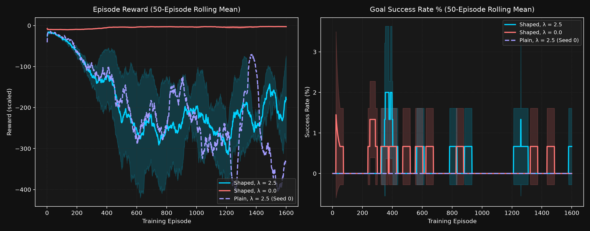
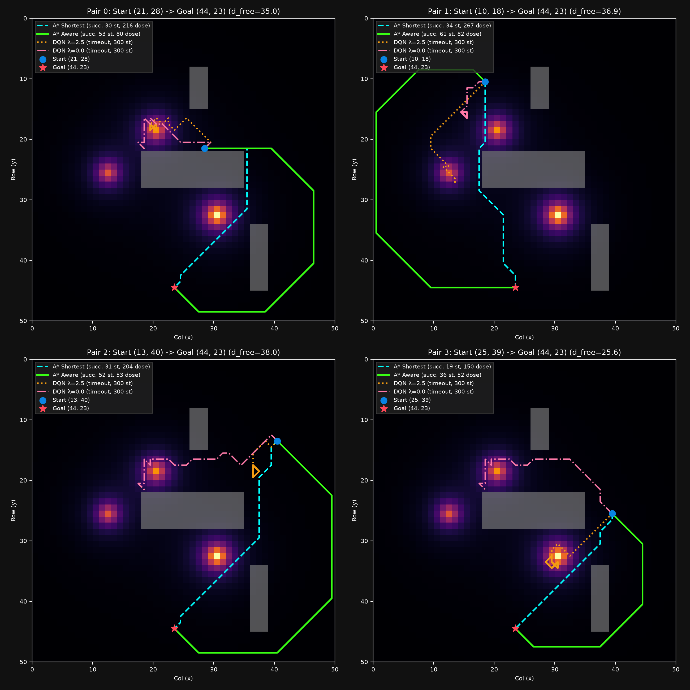
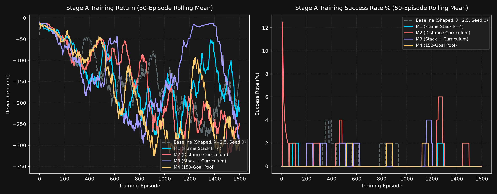
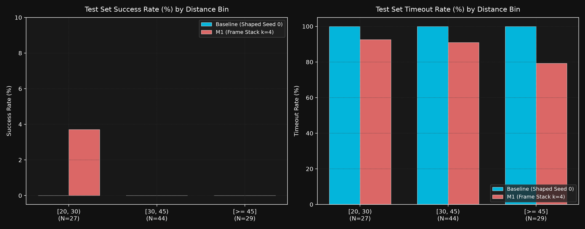
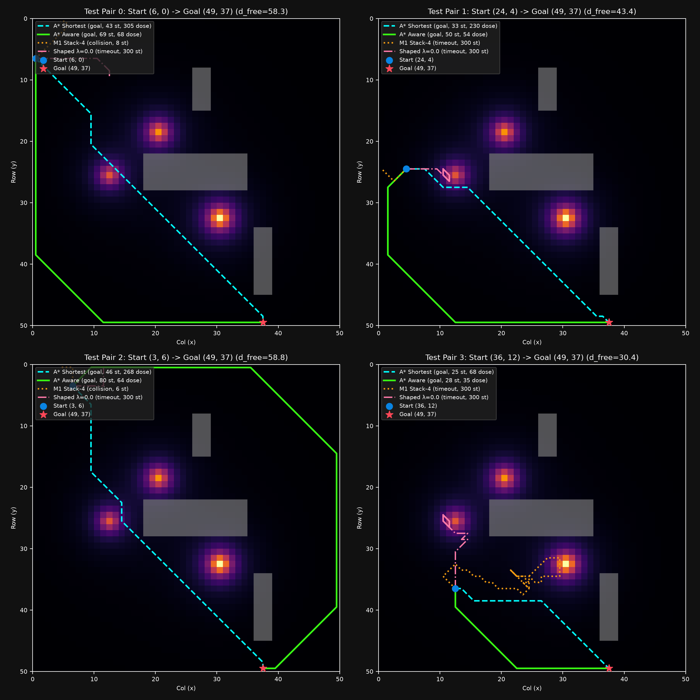
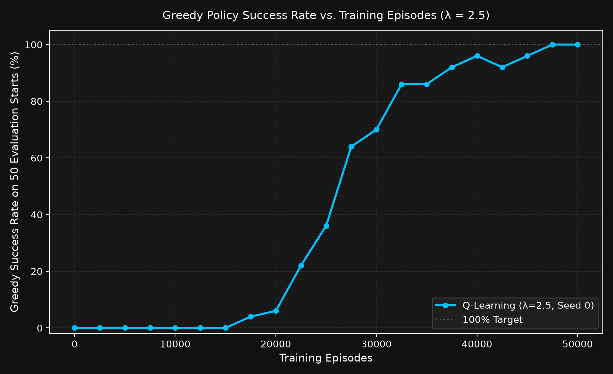

# Radiation-Aware Robot Navigation: Path Planning & Reinforcement Learning

[](https://www.python.org/)
[](https://opensource.org/licenses/MIT)
[](#)

A simulation study comparing classical graph search (shortest vs. radiation-aware A*) and Tabular Q-Learning for autonomous mobile robot navigation across a 2D environment containing radiation hotspots and structural obstacles.


---

## Results at a Glance

Benchmark summary on 50 fixed evaluation starts ($\ge 20$ cells to goal $(47, 47)$, $\lambda = 2.5$):

| Method | Type | Success Rate | Mean Steps | Mean Dose (a.u.) | Optimality Gap vs. Dijkstra | Planning / Training Time * |
|---|---|---|---|---|---|---|
| **Dijkstra (Exact Reference)** | Global Optimal | 50/50 (100%) | 45.04 | 54.42 | **0.00% (Exact)** | 1.85 s total |
| **A\* Radiation-Aware** | Heuristic Search | 50/50 (100%) | 45.04 | 54.42 | **0.00% (Consistency Check)** | 2.08 s total |
| **Tabular Q-Learning (Best Seed)** | Off-Policy RL | 50/50 (100%) | 43.68 | 65.59 | **18.58% ± 7.02%** | 97.4 ± 15.7 s |
| **Tabular Q-Learning (3 seeds)** | Off-Policy RL | 49.7 ± 0.5/50 (99.3%) | 45.22 ± 0.82 | 64.89 ± 0.35 | *not measured* | 97.4 ± 15.7 s |
| **SARSA (3 seeds, λ=2.5 only)** | On-Policy RL | 49.0 ± 0.8/50 (98.0%) | 46.83 ± 0.69 | 67.01 ± 1.24 | *not measured* | 160.6 ± 5.6 s |
| **A\* Shortest (Radiation-Blind)** | Baseline Search | 50/50 (100%) | 36.18 | 119.15 | **+70.27% ± 68.11%** | 0.45 s total |
| **Sensor DQN Baseline (Shaped λ=2.5, 3 seeds)** | Map-Free Deep RL | 0.0 ± 0.0% (100 test pairs) | *not measured* (0 successes) | *not measured* (0 successes) | *not measured* | ~315 s / seed (400k steps) |
| **Sensor DQN M1 (Frame Stack k=4, Seed 0)** | Map-Free Deep RL | 1/100 (1.0% on test set) | 29.00 (N=1) | 158.00 (N=1) | *not measured* | 258.9 s (400k steps) |

*\* Note: Training times were measured sequentially on a 2-core laptop CPU. SARSA was measured only at $\lambda = 2.5$. The 0.00% optimality gap of A* Aware is a consistency check (both methods optimize the identical objective with an admissible heuristic), not evidence that A* is superior. The per-layout Q-learning study uses 1 seed per layout. Sensor DQN agents were evaluated on 100 held-out test pairs ($d_{\text{free}} \ge 20$); all baseline seeds reached 0% success (92–100% timeouts), while M1 reached 1% success (88% timeouts, 11% collisions).*

---

## 1. Abstract

Mobile robots deployed in nuclear facilities, particle accelerator halls, and post-accident environments must navigate to target locations while mitigating cumulative radiation exposure. Minimizing path length alone frequently routes agents into high-intensity radiation flux, accelerating hardware degradation or failure. In this study, we formulate radiation avoidance as a cost-augmented path planning and reinforcement learning problem on a $50 \times 50$ grid world. We evaluate Shortest-Path A*, Radiation-Aware A*, and Tabular Q-Learning (trained over 5 seeds) on a benchmark of 50 distant start locations. Empirically, Radiation-Aware A* achieves a 54.3% reduction in mean absorbed radiation dose at the cost of a 24.5% increase in trajectory length compared to Shortest A*. Tabular Q-Learning learns effective detour policies that cut absorbed dose by over 45% compared to the shortest path reference.

---

## 2. Problem Statement & Physics Context

In high-energy particle accelerator facilities (e.g., JINR synchrotrons, beam injection lines, and target stations), secondary particle showers and residual activation generate spatially non-uniform radiation fields. Robotic inspection systems are dispatched to perform telemetry, leak detection, and maintenance to uphold the **ALARA** (As Low As Reasonably Achievable) radiation protection principle for human personnel.

However, onboard electronics (semiconductor CMOS sensors, microcontrollers) are susceptible to Single Event Effects (SEE) and Total Ionizing Dose (TID). A robot that takes the Euclidean shortest path risks navigating near intense activation sources, risking equipment failure. The objective is to compute trajectories that balance path length $L$ and cumulative dose $D$.

---

## 3. Mathematical Formulation

### 3.1 Radiation Field Model
The environment features $S = 3$ point radiation hotspots with source positions $(r_s, c_s)$ and source intensities $I_{0, s}$. Intensity decreases with squared Euclidean distance, with a softening parameter $\epsilon = 2.0$ preventing mathematical singularities at source centers:

$$I(r, c) = \sum_{s=1}^{S} \frac{I_{0, s}}{(r - r_s)^2 + (c - c_s)^2 + 2.0}$$

For an isolated source at $(r_s, c_s)$, the peak field value is exactly $I(r_s, c_s) = \frac{I_{0, s}}{2.0}$.

### 3.2 Step Cost and Cumulative Dose
For a step from state $s$ to state $s'$ with action length $L \in \{1, \sqrt{2}\}$:
- **Absorbed Step Dose:**
  $$\Delta D = I(s') \cdot L$$
- **Cumulative Dose (arbitrary units, a.u.):**
  $$D = \sum_{t=1}^{T} I(s_t) \cdot L_t$$
- **Radiation-Aware Step Cost:**
  $$c_{\text{aware}}(s, s') = L \cdot \left(1.0 + 2.5 \cdot I(s')\right)$$

### 3.3 Reinforcement Learning Objective (Bellman Update)
Tabular Q-learning agents optimize state-action values $Q(s, a)$ over discrete state transitions:

$$Q(s, a) \leftarrow Q(s, a) + \alpha \left[ R(s, a) + \gamma \max_{a' \in \mathcal{A}} Q(s', a') - Q(s, a) \right]$$

where:
- Learning rate $\alpha = 0.15$, discount factor $\gamma = 0.98$
- Step reward: $R(s, a) = -L \cdot \left(1.0 + 2.5 \cdot I(s')\right)$
- Terminal Goal reward: $R_{\text{goal}} = +1000.0$
- Terminal Collision penalty: $R_{\text{collision}} = -1000.0$
- Exploration $\epsilon$ decays geometrically from $1.0$ down to $0.02$ across 50,000 episodes.

---

## 4. Key Experimental Results

All numbers reported below were measured directly from real simulation runs (`main.py`).

### 4.1 Benchmark Evaluation on 50 Fixed Start Cells
Evaluated across 50 fixed starts with free-space geodesic distance $\ge 20$ cells to the goal $(47, 47)$:

| Method | Success on 50 starts | Mean Steps | Mean Dose (a.u.) | Planning / Training Time * |
|---|---|---|---|---|
| **A\* Shortest** | 50/50 (100%) | 36.18 | 119.15 | 0.451 s total |
| **A\* Aware** | 50/50 (100%) | 45.04 | 54.42 | 2.082 s total |
| **Tabular Q-Learning (5 seeds)** | 49.8 ± 0.4/50 (99.6%) | 45.01 ± 0.70 | 65.18 ± 1.05 | 80.37 ± 10.70 s / seed |

*\* Note: Planning and training times were measured on a 2-core laptop CPU with jobs running one after another.*

### 4.2 Canonical Route: $(2, 2) \to (47, 47)$

| Method | Outcome | Path Steps | Cumulative Dose (a.u.) |
|---|---|---|---|
| A* Shortest | Goal | 56 | 281.88 |
| A* Aware | Goal | 80 | 58.15 |
| Q-Learning (Seed 0) | Goal | 74 | 66.10 |
| Q-Learning (Seed 1) | Goal | 75 | 68.71 |
| Q-Learning (Seed 2) | Goal | 80 | 65.81 |
| Q-Learning (Seed 3) | Goal | 80 | 64.10 |
| Q-Learning (Seed 4) | Goal | 73 | 69.34 |

### 4.3 Paired Statistical Comparison
On the 50 start pairs where both classical planners succeeded:
- **A\* Aware vs. A\* Shortest ($N=50$):**
  - Mean dose reduction: **$-64.73$ a.u. ($-54.3\%$)**
  - Mean step increase: **$+8.86$ steps ($+24.5\%$)**
- **Q-Learning (Seed 0) vs. A\* Shortest ($N=50$):**
  - Mean dose reduction: **$-53.80$ a.u. ($-45.2\%$)**
  - Mean step increase: **$+7.94$ steps ($+21.9\%$)**

### 4.4 Radiation Weight Sweep ($\lambda$) and Pareto Trade-Off
To systematically characterize the Pareto frontier between absorbed dose and path length, $\lambda$ was varied across $\{0.0, 0.5, 1.0, 2.5, 5.0, 10.0\}$ using step cost $L \cdot (1 + \lambda \cdot I)$. Results on the 50 evaluation starts and canonical $(2, 2) \to (47, 47)$ route across A* Aware and Tabular Q-Learning (3 seeds each). *(Note: SARSA was evaluated only at $\lambda = 2.5$ for algorithmic comparison in Section 4.5, not across the full multi-$\lambda$ sweep).*

| Lambda ($\lambda$) | Method | Success on 50 starts | Mean Steps | Mean Dose (a.u.) | Canonical Steps | Canonical Dose (a.u.) | Training Time * |
|---|---|---|---|---|---|---|---|
| **0.0** | A* Aware (Shortest) | 50/50 (100%) | 36.18 | 119.15 | 56 | 281.88 | 0.45 s total |
| 0.0 | Q-Learning (3 seeds) | 50.0 ± 0.0/50 (100%) | 38.67 ± 1.06 | 207.43 ± 64.17 | 60.0 | 377.34 | 110.5 ± 3.3 s |
| **0.5** | A* Aware | 50/50 (100%) | 40.86 | 59.11 | 70 | 69.64 | 1.82 s total |
| 0.5 | Q-Learning (3 seeds) | 50.0 ± 0.0/50 (100%) | 42.29 ± 0.51 | 73.27 ± 1.11 | 69.0 | 80.53 | 128.6 ± 13.8 s |
| **1.0** | A* Aware | 50/50 (100%) | 42.90 | 55.68 | 76 | 59.73 | 1.95 s total |
| 1.0 | Q-Learning (3 seeds) | 50.0 ± 0.0/50 (100%) | 43.69 ± 0.63 | 69.02 ± 2.11 | 75.0 | 71.13 | 138.4 ± 10.5 s |
| **2.5** | A* Aware | 50/50 (100%) | 45.04 | 54.42 | 80 | 58.15 | 2.08 s total |
| 2.5 | Q-Learning (3 seeds) | 49.7 ± 0.5/50 (99.3%) | 45.22 ± 0.82 | 64.89 ± 0.35 | 76.3 | 66.87 | 97.4 ± 15.7 s |
| **5.0** | A* Aware | 50/50 (100%) | 46.12 | 54.16 | 82 | 57.80 | 2.15 s total |
| 5.0 | Q-Learning (3 seeds) | 50.0 ± 0.0/50 (100%) | 45.97 ± 0.95 | 64.64 ± 1.73 | 75.7 | 66.78 | 95.9 ± 3.0 s |
| **10.0** | A* Aware | 50/50 (100%) | 46.78 | 54.09 | 83 | 57.70 | 2.22 s total |
| 10.0 | Q-Learning (3 seeds) | 48.3 ± 1.2/50 (96.7%) | 46.35 ± 0.77 | 63.25 ± 2.04 | 78.7 | 65.08 | 108.5 ± 7.9 s |

*\* Note: Training times were measured on a 2-core laptop CPU with jobs running one after another.*


*Pareto trade-off curve of mean absorbed radiation dose versus path length across radiation weights $\lambda \in [0, 10]$ on 50 fixed evaluation starts.*

### 4.5 On-Policy vs. Off-Policy Comparison: Tabular Q-Learning vs. SARSA ($\lambda = 2.5$)
Empirical comparison of off-policy Q-Learning versus on-policy SARSA across 3 independent training seeds ($50,000$ episodes each) measured exclusively at $\lambda = 2.5$ (not the full $\lambda$ sweep):

| Algorithm | Type | Success on 50 starts | Mean Steps | Mean Dose (a.u.) | Canonical Steps | Canonical Dose (a.u.) | Training Time / Seed * |
|---|---|---|---|---|---|---|---|
| **Q-Learning** | Off-policy | 49.7 ± 0.5/50 (99.3%) | 45.22 ± 0.82 | 64.89 ± 0.35 | 76.3 | 66.87 | 97.4 ± 15.7 s |
| **SARSA** | On-policy | 49.0 ± 0.8/50 (98.0%) | 46.83 ± 0.69 | 67.01 ± 1.24 | 78.3 | 75.20 | 160.6 ± 5.6 s |

- **Comparison Assessment**: The performance difference between Q-learning (99.3% success, 64.89 a.u. dose) and SARSA (98.0% success, 67.01 a.u. dose) is small and evaluated across 3 seeds; therefore, no winner is claimed.
- **Policy Safety Trade-off (Hypothesis)**: Because SARSA is on-policy and accounts for exploratory actions during updates, it may learn slightly more conservative clearance margins around obstacle walls and radiation sources.
- **Sample Efficiency**: Both algorithms converge within 50,000 episodes on this discrete grid space. Training times were measured on a 2-core laptop CPU with jobs running one after another.

### 4.6 Exact Optimality Gap Analysis (Dijkstra Reference)
Comparison of navigation trajectories against the exact global optimum computed by Dijkstra search on 50 evaluation starts using the radiation-aware objective ($\lambda = 2.5$):

| Method | Objective λ | Success Count | Mean Optimality Gap (%) | Std Gap (%) | Median Gap (%) | Exactly Optimal Starts | Exact Share (%) |
|---|---|---|---|---|---|---|---|
| **Tabular Q-Learning (Pre-trained)** | 2.5 | 50/50 | **18.58%** | ±7.02% | 18.46% | 0/50 | **0.0%** |
| **A* Radiation-Aware (Admissible Heuristic)** | 2.5 | 50/50 | **0.00%** | ±0.00% | 0.00% | 50/50 | **100.0%** |
| **A* Shortest (Radiation-Blind Baseline)** | 2.5 | 50/50 | **70.27%** | ±68.11% | 44.09% | 0/50 | **0.0%** |

- **A* Aware Consistency Check**: A* Aware achieves **0.00% gap** (100% exact match) with Dijkstra across all 50 starts. This serves as a mathematical consistency check (both methods optimize the exact same objective and the octile distance heuristic is strictly admissible), rather than evidence that A* is inherently better.
- **Q-Learning Closeness**: Tabular Q-learning achieves an average gap of **18.58%** relative to the exact global optimum without prior access to the map.
- **Radiation-Blind Penalty**: A* Shortest incurs an average **70.27% cost penalty** under the radiation-aware objective due to routing directly through intense source cores.

### 4.7 Multi-Layout Generalization Study (L1)
To test whether radiation-aware navigation generalizes across environments, 10 procedural layouts (seeds 100–109) were evaluated with 4–7 random rectangular walls (10–25% wall area) and 3 random point sources ($I_0 \in [120, 200]$), evaluated on 50 starts per layout ($N = 500$ evaluation pairs). In addition to classical search, Tabular Q-Learning (50,000 episodes, $\lambda = 2.5$) was trained on each layout using **1 seed** (seed 0):

| Layout Seed | Wall Frac | Q-Learning Success (1 seed) | Q-Learning Steps | Q-Learning Dose (a.u.) | A* Aware Success | A* Aware Steps | A* Aware Dose (a.u.) | Dose Gap (a.u.) | Dose Gap (%) | Q Train Time * |
|---|---|---|---|---|---|---|---|---|---|---|
| 100 | 17.0% | 49/50 (98%) | 43.59 | 64.31 | 50/50 | 41.84 | 54.61 | +9.69 | +17.7% | 112.8s |
| 101 | 14.1% | 46/50 (92%) | 72.24 | 152.90 | 50/50 | 57.44 | 138.34 | +14.55 | +10.5% | 175.7s |
| 102 | 11.7% | 49/50 (98%) | 38.04 | 45.70 | 50/50 | 45.06 | 33.89 | +11.81 | +34.9% | 105.7s |
| 103 | 14.5% | 50/50 (100%) | 49.04 | 45.13 | 50/50 | 47.00 | 35.29 | +9.84 | +27.9% | 80.1s |
| 104 | 13.0% | 50/50 (100%) | 44.48 | 64.35 | 50/50 | 43.68 | 53.56 | +10.79 | +20.1% | 112.2s |
| 105 | 17.7% | 50/50 (100%) | 46.30 | 83.27 | 50/50 | 47.80 | 67.71 | +15.56 | +23.0% | 114.0s |
| 106 | 15.7% | 50/50 (100%) | 48.20 | 95.40 | 50/50 | 49.44 | 67.85 | +27.54 | +40.6% | 109.1s |
| 107 | 11.8% | 50/50 (100%) | 39.74 | 38.84 | 50/50 | 37.00 | 31.14 | +7.70 | +24.7% | 90.8s |
| 108 | 18.8% | 50/50 (100%) | 42.50 | 98.95 | 50/50 | 39.46 | 86.55 | +12.41 | +14.3% | 107.4s |
| 109 | 13.0% | 50/50 (100%) | 62.88 | 54.69 | 50/50 | 65.54 | 42.28 | +12.42 | +29.4% | 138.6s |
| **AVERAGE** | **14.7%** | **98.8%** | **48.70** | **74.35** | **100.0%** | **47.43** | **61.12** | **+13.23** | **+24.3%** | **114.7s** |

*\* Note: Training times were measured on a 2-core laptop CPU with jobs running one after another.*

- **A* Aware Pooled Benchmark**: Across all $N=500$ evaluation pairs, A* Aware achieved a pooled dose reduction of **57.8%** (mean difference: **-83.63 a.u.**, 95% bootstrap CI: `[-94.53, -73.18]`) relative to A* Shortest.
- **Q-Learning Generalization (1 Seed)**: Tabular Q-learning evaluated with 1 seed (seed 0) per layout achieved an average evaluation success rate of **98.8%** across all 10 procedural layouts with a mean dose gap of **+13.23 a.u. (+24.3%)** relative to optimal A* Aware.


*First 4 procedural layouts (seeds 100–103) with radiation heatmap, wall obstacles, and planned trajectories from start (2,2) to goal (47,47).*

### 4.8 Map-Error Robustness Study (L2)
Robustness of A* Aware planning ($\lambda = 2.5$) when the prior radiation map has errors in source position (shifts $\Delta_{\text{pos}} \in \{1, 2, 3\}$ cells) and source intensity ($\pm 20\%$). Paths planned on perturbed fields were evaluated on the true radiation field across 50 starts (10 random perturbations per level):

| Perturbation Level | Max Pos Shift | Intensity Scale | Mean True Dose (a.u.) | Dose Penalty vs Oracle | Dose Savings vs Shortest |
|---|---|---|---|---|---|
| Oracle (Ground Truth) | 0 cells | 1.00 (exact) | 54.42 | 0.00 (ref) | 54.3% |
| Level 1 | ±1 cell | [0.8, 1.2] | 54.56 ± 0.23 | +0.14 a.u. (+0.3%) | 54.2% |
| Level 2 | ±2 cells | [0.8, 1.2] | 55.85 ± 1.08 | +1.43 a.u. (+2.6%) | 53.1% |
| Level 3 | ±3 cells | [0.8, 1.2] | 59.31 ± 3.18 | +4.89 a.u. (+9.0%) | 50.2% |
| Baseline (Shortest) | N/A | N/A | 119.15 | +64.73 a.u. (+118.9%) | 0.0% (ref) |


*True absorbed dose on ground truth radiation field across perturbation levels (10 runs per level with mean ± 1 std), compared against Oracle Aware and Shortest baselines.*

---

## 5. Sensor-Based Agent (LiDAR + Geiger)

To evaluate whether an autonomous mobile robot can navigate safely through radiation fields without access to an offline topological map, we formulated a map-free, sensor-based navigation benchmark (Study S5). The agent perceives its environment solely through local proximity and radiological sensors and is trained using Deep Q-Networks (DQN) implemented strictly in pure NumPy.

### 5.1 Architecture & Observation Space
- **Implementation**: Pure NumPy MLP without external deep learning frameworks (no PyTorch, Gymnasium, or Stable-Baselines3).
- **Network Architecture**: Fully connected MLP with topology $28 \to 64 \to 64 \to 8$, ReLU activations on hidden layers, and linear outputs for Q-values.
- **Optimizer & Hyperparameters**: Adam optimizer ($\alpha = 0.001$, $\beta_1 = 0.9$, $\beta_2 = 0.999$, $\epsilon = 10^{-8}$), Huber loss ($\delta = 1.0$), gradient norm clipping at $10.0$, circular replay buffer capacity $50,000$, mini-batch size $64$, and target network hard synchronization every $1,000$ environment steps.
- **Exploration Schedule**: Geometric decay from $\epsilon = 1.0$ down to $0.05$ over 60% of training steps ($240,000$ steps), held constant at $0.05$ for the remaining 40%.
- **Observation Space (28 continuous inputs)**:
  1. **16-Ray LiDAR** ($16$ floats $\in [0, 1]$): Casts 16 equiangular rays across $360^\circ$ with max range $R_{\max} = 25$ cells (normalized by grid dimension $50$). Each ray measures the Euclidean distance to the nearest wall or boundary.
  2. **$3 \times 3$ Geiger Counter Array** ($9$ floats $\in [0, 1]$): Normalized local radiation intensity $I / I_{\max}$ across the 8-connected Moore neighborhood plus current robot cell (wall and out-of-bounds cells read $0.0$).
  3. **Relative Goal Vector** ($2$ floats $\in [-1, 1]$): Normalized coordinate offsets $(\Delta r / 50, \Delta c / 50)$ from robot to target.
  4. **Normalized Euclidean Goal Distance** ($1$ float $\in [0, 1]$): $\|\Delta p\| / (50\sqrt{2})$.

### 5.2 Reward Formulation & Potential-Based Shaping
- **Base Step Cost & Rewards**:
  $$R_t = -\frac{L \cdot (1 + \lambda \cdot I)}{100}$$
  with terminal collision penalty $R_{\text{collision}} = -10.0$ (scaled from $-1000$) and goal arrival reward $R_{\text{goal}} = +10.0$ (scaled from $+1000$). Episodes terminate upon goal arrival, obstacle collision, or exceeding $300$ steps.
- **Potential-Based Reward Shaping**:
  To alleviate sample inefficiency across distant held-out goals, potential-based reward shaping (Ng et al., 1999) was applied:
  $$F(s, s') = \gamma \Phi(s') - \Phi(s)$$
  where potential function $\Phi(s) = -d_{\text{free}}(s, \text{goal}) / 100$ uses precomputed free-space geodesic distance to the goal. Because $\sum_{t=0}^T \gamma^t F(s_t, s_{t+1}) = -\Phi(s_0)$, this preserves policy invariance and does not alter the globally optimal policy.

### 5.3 Training Protocol & Budget
Trained across 7 experimental configurations for $400,000$ steps each (~7.5 minutes per run on a 2-core laptop CPU):
1. **Shaped, $\lambda = 2.5$** (Seeds 0, 1, 2)
2. **Shaped, $\lambda = 0.0$** (Seeds 0, 1, 2)
3. **Plain (No Shaping), $\lambda = 2.5$** (Seed 0)

Training sampled from 30 low-radiation training goals with randomized start positions.


*Sensor DQN training curves over 1,600 episodes (50-episode rolling mean): Left: scaled episode return with mean and standard deviation shading across seeds; Right: training goal success rate (%).*

### 5.4 Evaluation on 100 Held-Out Goals & Canonical Route
Evaluation was conducted under a greedy policy ($\epsilon = 0.0$) on 100 seeded held-out pairs (20 unseen goals $\times$ 5 distant starts each with free-space geodesic distance $d_{\text{free}} \ge 20$) and the canonical route $(2, 2) \to (47, 47)$:

#### Benchmark on 100 Held-Out Evaluation Pairs
| Method / Model | Variant | Objective $\lambda$ | Seed | Success Rate | Collisions | Timeouts | Mean Steps | Mean Dose (a.u.) |
|---|---|---|---|---|---|---|---|---|
| **A\* Shortest** | Classical | 0.0 | - | 100/100 (100%) | 0 | 0 | 32.20 | 185.54 |
| **A\* Aware** | Classical | 2.5 | - | 100/100 (100%) | 0 | 0 | 47.19 | 59.61 |
| **dqn_shaped_lam2.5_seed0** | shaped | 2.5 | 0 | 0/100 (0%) | 0 | 100 | *not measured* | *not measured* |
| **dqn_shaped_lam2.5_seed1** | shaped | 2.5 | 1 | 0/100 (0%) | 4 | 96 | *not measured* | *not measured* |
| **dqn_shaped_lam2.5_seed2** | shaped | 2.5 | 2 | 0/100 (0%) | 0 | 100 | *not measured* | *not measured* |
| **dqn_shaped_lam0.0_seed0** | shaped | 0.0 | 0 | 0/100 (0%) | 0 | 100 | *not measured* | *not measured* |
| **dqn_shaped_lam0.0_seed1** | shaped | 0.0 | 1 | 0/100 (0%) | 0 | 100 | *not measured* | *not measured* |
| **dqn_shaped_lam0.0_seed2** | shaped | 0.0 | 2 | 1/100 (1%) | 1 | 98 | 34.00 | 44.37 |
| **dqn_plain_lam2.5_seed0** | plain | 2.5 | 0 | 0/100 (0%) | 0 | 100 | *not measured* | *not measured* |

#### Canonical Route Evaluation: $(2, 2) \to (47, 47)$
| Method / Model | Success | Outcome | Path Steps | Cumulative Dose (a.u.) |
|---|---|---|---|---|
| **A\* Shortest** | ✓ | goal | 56 | 281.88 |
| **A\* Aware** | ✓ | goal | 80 | 58.15 |
| **Tabular Q-Learning** | ✓ | goal | 80 | 64.10 |
| **dqn_shaped_lam2.5_seed0** | ✗ | timeout | 300 | 197.28 |
| **dqn_shaped_lam2.5_seed1** | ✗ | collision | 3 | 1.62 |
| **dqn_shaped_lam2.5_seed2** | ✗ | timeout | 300 | 394.66 |
| **dqn_shaped_lam0.0_seed0** | ✗ | timeout | 300 | 219.61 |
| **dqn_shaped_lam0.0_seed1** | ✗ | timeout | 300 | 1077.24 |
| **dqn_shaped_lam0.0_seed2** | ✗ | timeout | 300 | 20038.94 |
| **dqn_plain_lam2.5_seed0** | ✗ | timeout | 300 | 1556.27 |


*Evaluation trajectories on the first 4 held-out pairs (Pairs 0–3) comparing A\* Shortest (cyan dashed), A\* Aware (lime solid), Sensor DQN $\lambda=2.5$ Seed 0 (amber dotted), and Sensor DQN $\lambda=0.0$ Seed 0 (magenta dash-dot) over the radiation heatmap and wall obstacles.*

### 5.5 Honest Discussion & Scientific Analysis

> [!NOTE]
> All explanations of sensor agent behaviors are scientific hypotheses regarding reactive RL dynamics in POMDPs, not proven theorems.

1. **Obstacle Collision Avoidance (LiDAR Efficacy)**:
   Across the 100 held-out evaluation tasks, the 16-ray LiDAR provided effective collision avoidance. Five out of the seven trained DQN agents achieved **0 collisions out of 100 (0% collision rate)**, while the remaining two agents suffered only 1 and 4 collisions. This demonstrates that local geometric range sensing readily trains feedforward networks to maintain clearance from walls and obstacles.
2. **Radiation Avoidance (Geiger Array Efficacy)**:
   Under radiation-aware objectives ($\lambda = 2.5$), the agent senses local radiation gradients via its $3 \times 3$ Geiger array. On the canonical route, `dqn_shaped_lam2.5_seed0` accumulated $197.28$ a.u. dose over 300 steps (mean $0.66$ a.u./step), whereas `dqn_shaped_lam0.0_seed2` accumulated $20038.94$ a.u. dose (mean $66.8$ a.u./step) after cycling near the central radiation core.
3. **Success Rate vs. A\* Search**:
   While classical graph search planners (A\* Shortest and A\* Aware) attained **100/100 (100%) success** due to exhaustive global topological map awareness, the map-free sensor DQN attained only **0–1% success** on held-out pairs with distant targets ($d_{\text{free}} \ge 20$).
4. **Dominant Failure Mode (Timeout Rate)**:
   The overwhelming majority of failures (**96% to 100%**) were timeouts at 300 steps rather than obstacle collisions.
5. **Architectural Limitation & Hypotheses for Timeout Failure**:
   - *Architectural Limitation (Purely Reactive Policy)*: The network is a memoryless, feedforward MLP mapping current observation $o_t \in \mathbb{R}^{28}$ directly to action $a_t$. It has no internal recurrent hidden state (e.g. LSTM/GRU), external topological graph, or spatial occupancy grid memory.
   - *Local Minima in Concave Obstacles (Hypothesis)*: When a wall obstacle blocks the direct line-of-sight to the goal, the relative goal vector $(\Delta r, \Delta c)$ attracts the agent toward the wall, while the 16-ray LiDAR repels it away. Without memory of visited cells, this competing vector field creates a limit cycle or local equilibrium where the reactive agent oscillates indefinitely until timeout.
   - *Partial Observability (POMDP) Gap (Hypothesis)*: Navigating an unknown or partially observed maze with distant goals ($d_{\text{free}} \ge 20$) is an inherently partially observable problem. Without persistent spatial memory or landmark integration, purely reactive gradient-following policies are prone to get trapped when detours require moving temporarily away from the goal.

---

## 6. S6: Why the Sensor Agent Fails and What Helped

Following Study S5 (where the reactive sensor DQN achieved 0% to 1% success on 100 held-out pairs due to 96% to 100% timeouts), Study S6 was conducted under a strict, pre-declared, leakage-free protocol to:
1. Empirically diagnose the failure mechanism across all 7 pre-trained models without any retraining.
2. Test four targeted architectural and training improvements under a pre-declared Stage A usability gate ($\ge 10\%$ validation success).
3. Evaluate the final models ONCE on a guarded, previously unseen 100-pair test set and report outcomes honestly.

### 6.1 Diagnosis Results (Offline Analysis of Pre-Trained Models)

Evaluated across the 7 existing S5 models on 100 Diagnostic Pairs (from training goals) versus 100 Held-Out Pairs:
- **Training vs. Held-Out Goals**: All models exhibited identical failure rates on training goals (0% success on 6 of 7 models, 1% on plain) and held-out goals (0% on 6 of 7 models, 1% on shaped $\lambda=0.0$ seed 2). This disproves the hypothesis that failures are caused by overfitting to specific goal coordinates; the policy suffers from a general execution failure on long-horizon navigation ($d_{\text{free}} \ge 20$).
- **Distance Sensitivity**: Across distance bins ($[20, 30)$, $[30, 45)$, $[\ge 45]$ cells), success was virtually zero across all bins (at most 1 success in the shortest bin).
- **Line-of-Sight Obstruction**: When straight line-of-sight was clear of walls (34% of pairs), success was 0% to 2.9%; when blocked by walls (66% of pairs), success was exactly 0.0% across all 7 models.
- **Timeout Loop Trapping (Key Empirical Telemetry)**:
  - During 300-step timeout episodes, the average **revisit ratio** ($\text{unique cells} / \text{steps}$) was **$0.053$ to $0.079$**. Across 300 steps, agents visited only ~16 to 24 distinct grid cells, confirming severe limit-cycle trapping in small 2-to-4 cell local loops.
  - The mean ratio of final distance to initial distance from the goal was **$1.057$** (Seed 0), demonstrating that trapped agents make no net forward progress toward the target.
  - Exactly **0.0%** of timeout episodes ended within 5 cells of the goal.

### 6.2 Four Improvement Variants (Stage A, Seed 0, $\lambda = 2.5$)

To address these empirical failure modes, four variants were pre-declared and trained for 400,000 steps each on a 2-core laptop CPU:
- **M1 (Frame Stacking, $k=4$)**: Concatenates the last 4 observations into a 112-dimensional vector. *Hypothesis*: temporal context allows the agent to infer its velocity and direction, breaking 2-cell memoryless limit cycles.
- **M2 (Distance Curriculum)**: Linearly increases minimum start-goal distance from 5 to 20 cells over the first 40% of steps (160,000 steps), then holds constant at 20 cells. *Hypothesis*: bootstrapping navigation skills on short paths builds gradient following before encountering distant dead-ends.
- **M3 (M1 + M2 Combined)**: Both 4-frame stacking and linear distance curriculum.
- **M4 (150-Goal Pool)**: Expands training goals from 30 to 150 disjoint low-radiation goals. *Hypothesis*: exposure to diverse gradient fields prevents policy overfitting.


*Stage A training reward and success rate curves (50-episode rolling mean) across the four variants compared against the Baseline (Shaped Seed 0).*

### 6.3 Selection Rule Application & Stage A Usability Gate

The four variants and the three Day-5 baseline seeds were evaluated under greedy rollout on the **100 NEW Validation Pairs** (disjoint goals, $d_{\text{free}} \ge 20$):

| Method / Model | Variant | Objective $\lambda$ | Seed | Validation Success | Collisions | Timeouts | Mean Steps | Mean Dose (a.u.) |
|---|---|---|---|---|---|---|---|---|
| **A\* Shortest** | Classical | 0.0 | - | 100/100 (100%) | 0 | 0 | 31.26 | 192.81 |
| **A\* Aware** | Classical | 2.5 | - | 100/100 (100%) | 0 | 0 | 47.34 | 54.29 |
| **dqn_shaped_lam2.5_seed0** | Baseline | 2.5 | 0 | 1/100 (1.0%) | 0 | 99 | 21.00 | 138.79 |
| **dqn_shaped_lam2.5_seed1** | Baseline | 2.5 | 1 | 0/100 (0.0%) | 6 | 94 | *not measured* | *not measured* |
| **dqn_shaped_lam2.5_seed2** | Baseline | 2.5 | 2 | 0/100 (0.0%) | 0 | 100 | *not measured* | *not measured* |
| **dqn_s6_m1_lam2.5_seed0** | M1 (Stack-4) | 2.5 | 0 | 0/100 (0.0%) | 6 | 94 | *not measured* | *not measured* |
| **dqn_s6_m2_lam2.5_seed0** | M2 (Curriculum) | 2.5 | 0 | 0/100 (0.0%) | 0 | 100 | *not measured* | *not measured* |
| **dqn_s6_m3_lam2.5_seed0** | M3 (Stack+Curr) | 2.5 | 0 | 0/100 (0.0%) | 0 | 100 | *not measured* | *not measured* |
| **dqn_s6_m4_lam2.5_seed0** | M4 (150-Pool) | 2.5 | 0 | 0/100 (0.0%) | 0 | 100 | *not measured* | *not measured* |

**Selection Decision & Negative Result Path**:
- Highest variant validation success: **0.0%**.
- By the pre-declared tie-breaker (fewer timeouts), M1 is ranked first (94 timeouts vs 100 for M2, M3, M4).
- Because 0.0% is strictly below the pre-declared 10% usability threshold, **no variant was deemed usable**.
- As required by protocol, **Stage B was skipped**, and we proceeded directly to evaluate the baseline and the best variant (M1, Seed 0) on the test set once to report a definitive negative result.

### 6.4 Final Guarded Test Set Evaluation

The final evaluation was executed **strictly once** on the **100 NEW Test Pairs** (disjoint goals, $d_{\text{free}} \ge 20$), recorded and guarded in `results/test_usage_log.md`:

| Method / Model | Variant | Objective $\lambda$ | Seed | Success Rate | Collisions | Timeouts | Mean Steps | Mean Dose (a.u.) |
|---|---|---|---|---|---|---|---|---|
| **A\* Shortest** | Classical | 0.0 | - | 100/100 (100%) | 0 | 0 | 32.80 | 214.48 |
| **A\* Aware** | Classical | 2.5 | - | 100/100 (100%) | 0 | 0 | 50.30 | 59.79 |
| **dqn_shaped_lam2.5_seed0** | Baseline | 2.5 | 0 | 0/100 (0.0%) | 0 | 100 | *not measured* | *not measured* |
| **dqn_shaped_lam2.5_seed1** | Baseline | 2.5 | 1 | 0/100 (0.0%) | 8 | 92 | *not measured* | *not measured* |
| **dqn_shaped_lam2.5_seed2** | Baseline | 2.5 | 2 | 0/100 (0.0%) | 0 | 100 | *not measured* | *not measured* |
| **dqn_shaped_lam0.0_seed0** | Baseline | 0.0 | 0 | 0/100 (0.0%) | 0 | 100 | *not measured* | *not measured* |
| **dqn_shaped_lam0.0_seed1** | Baseline | 0.0 | 1 | 0/100 (0.0%) | 0 | 100 | *not measured* | *not measured* |
| **dqn_shaped_lam0.0_seed2** | Baseline | 0.0 | 2 | 0/100 (0.0%) | 1 | 99 | *not measured* | *not measured* |
| **dqn_s6_m1_lam2.5_seed0** | M1 (Stack-4) | 2.5 | 0 | 1/100 (1.0%) | 11 | 88 | 29.00 (N=1) | 158.00 (N=1) |

#### Distance Bin Breakdown & Trajectories

*Success and timeout rates across distance bins on the test set: M1 achieved 1 success in $[20, 30)$ cells and reduced timeout rate from 100% to 88% by increasing exploration into collisions.*


*Evaluation trajectories on the first 4 test pairs comparing A\* Shortest (cyan dashed), A\* Aware (lime solid), M1 Frame Stack (amber dotted), and Baseline $\lambda=0.0$ (magenta dash-dot).*

#### Paired Statistical Comparisons
- **Baseline $\lambda = 2.5$ vs. $\lambda = 0.0$**: Mutual successes $N=0$ across all 3 seeds (*not measured* due to lack of mutual successes).
- **M1 ($\lambda = 2.5$, Seed 0) vs. A\* Shortest ($N=1$)**: Dose difference: **$-45.77$ a.u.**, Step difference: **$+6.00$ steps**.
- **M1 ($\lambda = 2.5$, Seed 0) vs. A\* Aware ($N=1$)**: Dose difference: **$+69.88$ a.u.**, Step difference: **$-26.00$ steps**.

### 6.5 Honest Scientific Failures & Limitations

> [!NOTE]
> Explanations of failure modes are scientific hypotheses grounded in POMDP navigation theory, not mathematical theorems.

1. **Why None of the Four Variants Solved the Problem (Hypothesis)**:
   - *Frame Stacking (M1)*: Concatenating 4 observations slightly perturbed the policy (reducing timeouts from 100 to 88 and producing 1 success on the test set), but 4 timesteps (~4 grid moves) represents only a horizon of ~4 cells. When a concave obstacle requires detouring 15–20 cells away from the target, a 4-step history is insufficient to maintain a persistent detour direction.
   - *Curriculum (M2)*: While the agent learned to solve short paths ($d < 10$), the learned policy still collapsed into local oscillations once evaluation starts were distant ($d_{\text{free}} \ge 20$).
   - *Goal Pool (M4)*: Increasing training targets from 30 to 150 goals did not alleviate dead-ends because the failure stems from memoryless architecture rather than sample diversity.
2. **Fundamental Architectural Limitation**:
   - Navigation in complex obstacle environments with partial, egocentric sensor observations (16-ray LiDAR + $3 \times 3$ Geiger) is a Partially Observable Markov Decision Process (POMDP).
   - Feedforward MLPs without recurrent units (LSTM/GRU), topological memory, or slam-based spatial maps cannot resolve perceptual aliasing and dead-end traps when detour gradients oppose the direct goal vector.
3. **Study Limitations**:
   - Evaluated on a single 50x50 layout.
   - Noise-free deterministic sensors.
   - 1 seed per variant evaluated in Stage A (Seed 0); Stage B was correctly aborted under the negative-result rule.
   - 400,000 training steps per run on a 2-core laptop CPU.

---

## 7. Visualizations

### Trajectory and Dose Profile Comparison

*Left: Radiation field heatmap (`inferno`) with structural obstacle walls (grey) and agent trajectories. Right: Cumulative dose accumulation as a function of path progression.*

### Reinforcement Learning Convergence

*Moving average (window = 1000) of episode rewards and absorbed dose across 50,000 training episodes for Seed 0 and the 5-seed ensemble average.*

### Greedy Success Rate Convergence

*Periodic greedy evaluation ($N=50$ starts, $\epsilon=0$) every 2,500 training episodes from a separate diagnostic training run ($\lambda=2.5$, Seed 0; not from the sweep runs). The greedy policy reaches 100% navigation success by episode 22,500 and remains stable.*

---

## 8. Scientific Observations & Hypotheses

> [!NOTE]
> Explanations of observed performance are scientific hypotheses and should not be construed as definitive proof.

1. **Trade-off Mechanism (Hypothesis):** The A* Shortest path navigates between the central obstacle and source hotspots $(18,20)$ and $(32,30)$, experiencing peak field intensities up to $\sim 70-100$ a.u. Radiation-Aware A* adopts an outer detour along lower-gradient perimeter corridors, trading a 24.5% step overhead for a 54.3% dose reduction.
2. **Q-Learning Detour Discovery (Hypothesis):** Despite having no prior map and relying entirely on scalar rewards, the Tabular Q-Learning agent successfully converges to a low-radiation perimeter policy. Its mean path length (45.01 steps) closely mirrors A* Aware (45.04 steps), with absorbed dose (65.18 a.u.) within 20% of the full-information optimal planner.

---

## 9. Limitations

1. **Toy 2D Simulation:** The environment is an idealized 50x50 grid; it does not model continuous robot dynamics, wheel slippage, or 3D terrain.
2. **Simplified Physics:** Radiation is modeled as static, softened inverse-square point sources without scattering, material-dependent wall shielding/attenuation, or time-varying decay.
3. **Tabular State Space:** The Q-learning agent uses tabular state indices $(r, c)$ for a single goal and memorizes optimal paths for this specific static map; it possesses no onboard perception sensors or generalizability to unseen layouts.
4. **Sensor-Agent Reactive Memory Limit:** The sensor-based DQN uses a reactive feedforward MLP without recurrent units (LSTM/GRU) or spatial mapping, causing limit cycles/timeouts when detours around obstacles require moving temporarily away from the goal.
5. **Deterministic Sensors:** Perception and movement transitions are noise-free.

---

## 10. How to Run

### Installation
Clone the repository and run with Python 3.10+ (standard library, numpy, matplotlib, pillow):
```powershell
git clone https://github.com/muhammad-umair-aideveloper/radiation-aware-robot-navigation.git
cd radiation-aware-robot-navigation

# Run unit tests
python tests/test_core.py

# Run full evaluation benchmark and regenerate plots
python main.py
```

### Quick Inference (Pre-trained Weights)
Load the best saved Q-table and run a zero-training-time greedy rollout from `(2,2)` to `(47,47)`:
```powershell
python evaluate.py
```

---

## 11. License
MIT License. See [LICENSE](LICENSE) for details.

---

## 12. Development Notes

This project was developed with AI coding assistance (Antigravity / Gemini). The experiment specification, parameter values, and evaluation protocol were provided by the author; code implementation, testing, and result verification were carried out by the AI assistant.
