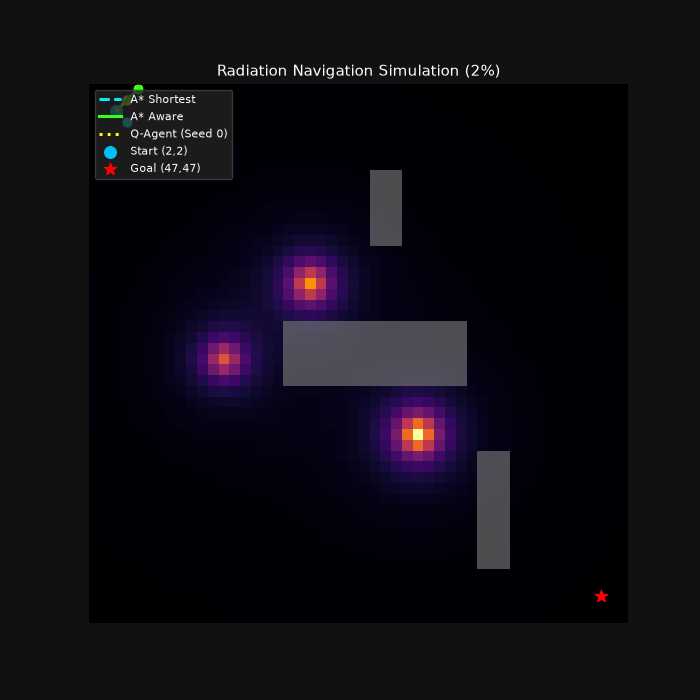
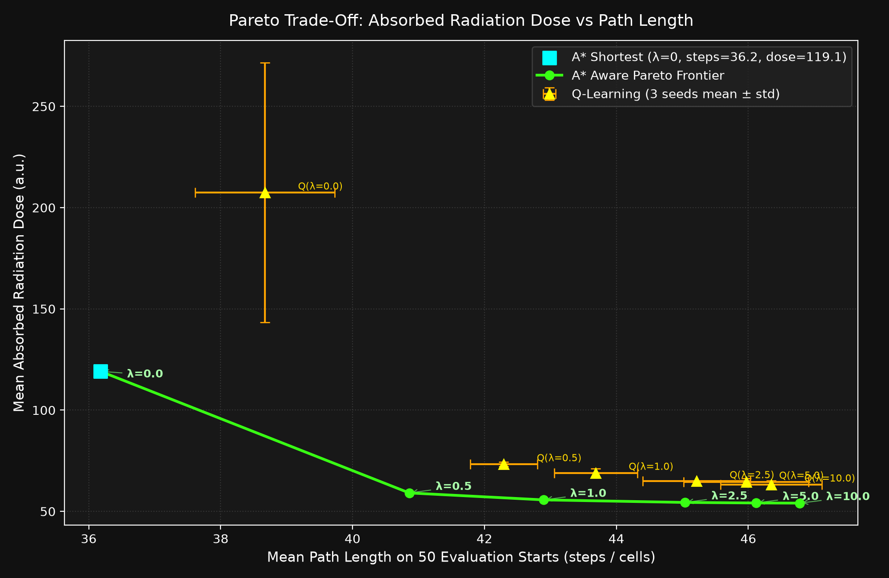
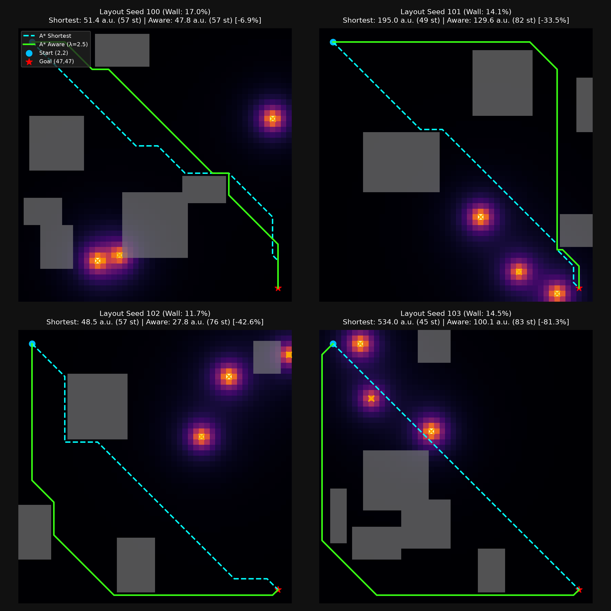
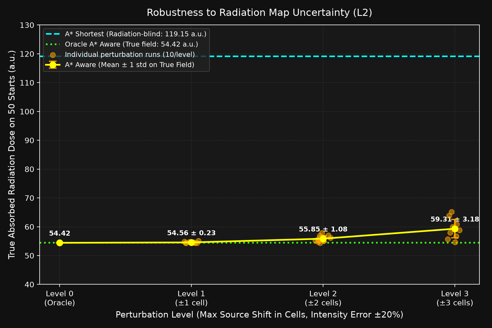
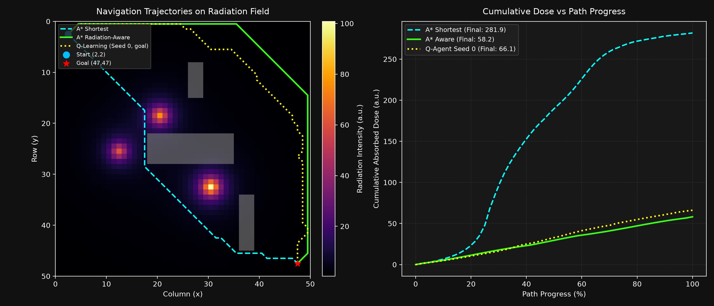
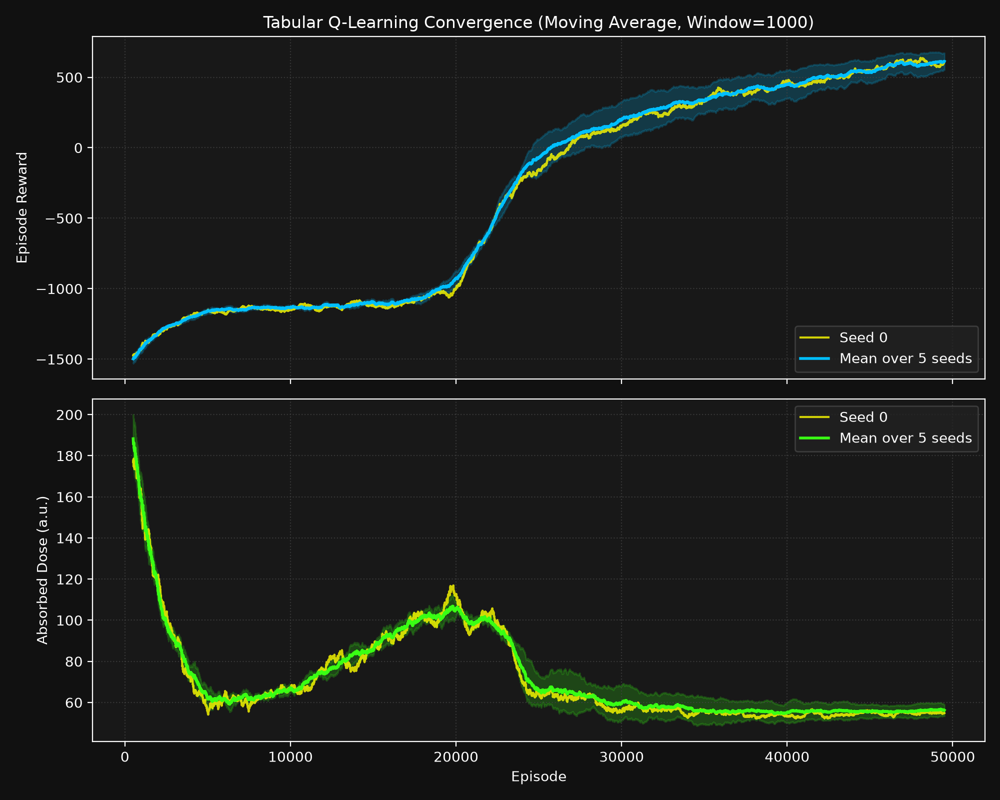

# Radiation-Aware Robot Navigation: Path Planning & Reinforcement Learning

[](https://www.python.org/)
[](https://opensource.org/licenses/MIT)
[](#)

A simulation study comparing classical graph search (shortest vs. radiation-aware A*) and Tabular Q-Learning for autonomous mobile robot navigation across a 2D environment containing radiation hotspots and structural obstacles.



---

## 1. Abstract

Mobile robots deployed in nuclear facilities, particle accelerator halls, and post-accident environments must navigate to target locations while mitigating cumulative radiation exposure. Minimizing path length alone frequently routes agents into high-intensity radiation flux, accelerating hardware degradation or failure. In this study, we formulate radiation avoidance as a cost-augmented path planning and reinforcement learning problem on a $50 \times 50$ grid world. We evaluate Shortest-Path A*, Radiation-Aware A*, and Tabular Q-Learning (trained over 5 seeds) on a benchmark of 50 distant start locations. Empirically, Radiation-Aware A* achieves a 54.3% reduction in mean absorbed radiation dose at the cost of a 24.5% increase in trajectory length compared to Shortest A*. Tabular Q-Learning learns effective detour policies that cut absorbed dose by over 45% compared to the shortest path reference.

---

## 2. Problem Statement & Physics Context

In high-energy particle accelerator facilities (e.g., JINR synchrotrons, beam injection lines, and target stations), secondary particle showers and residual activation generate spatially non-uniform radiation fields. Robotic inspection systems are dispatched to perform telemetry, leak detection, and maintenance to uphold the **ALARA** (As Low As Reasonably Achievable) radiation protection principle for human personnel.

However, onboard electronics (semiconductor CMOS sensors, microcontrollers) are susceptible to Single Event Effects (SEE) and Total Ionizing Dose (TID). A robot that takes the Euclidean shortest path risks navigating near intense activation sources, risking equipment failure. The objective is to compute trajectories that balance path length $L$ and cumulative dose $D$.

---

## 3. Mathematical Formulation

### 3.1 Radiation Field Model
The environment features $S = 3$ point radiation hotspots with source positions $(r_s, c_s)$ and source intensities $I_{0, s}$. Intensity decreases with squared Euclidean distance, with a softening parameter $\epsilon = 2.0$ preventing mathematical singularities at source centers:

$$I(r, c) = \sum_{s=1}^{S} \frac{I_{0, s}}{(r - r_s)^2 + (c - c_s)^2 + 2.0}$$

For an isolated source at $(r_s, c_s)$, the peak field value is exactly $I(r_s, c_s) = \frac{I_{0, s}}{2.0}$.

### 3.2 Step Cost and Cumulative Dose
For a step from state $s$ to state $s'$ with action length $L \in \{1, \sqrt{2}\}$:
- **Absorbed Step Dose:**
  $$\Delta D = I(s') \cdot L$$
- **Cumulative Dose (arbitrary units, a.u.):**
  $$D = \sum_{t=1}^{T} I(s_t) \cdot L_t$$
- **Radiation-Aware Step Cost:**
  $$c_{\text{aware}}(s, s') = L \cdot \left(1.0 + 2.5 \cdot I(s')\right)$$

### 3.3 Reinforcement Learning Objective (Bellman Update)
Tabular Q-learning agents optimize state-action values $Q(s, a)$ over discrete state transitions:

$$Q(s, a) \leftarrow Q(s, a) + \alpha \left[ R(s, a) + \gamma \max_{a' \in \mathcal{A}} Q(s', a') - Q(s, a) \right]$$

where:
- Learning rate $\alpha = 0.15$, discount factor $\gamma = 0.98$
- Step reward: $R(s, a) = -L \cdot \left(1.0 + 2.5 \cdot I(s')\right)$
- Terminal Goal reward: $R_{\text{goal}} = +1000.0$
- Terminal Collision penalty: $R_{\text{collision}} = -1000.0$
- Exploration $\epsilon$ decays geometrically from $1.0$ down to $0.02$ across 50,000 episodes.

---

## 4. Key Experimental Results

All numbers reported below were measured directly from real simulation runs (`main.py`).

### 4.1 Benchmark Evaluation on 50 Fixed Start Cells
Evaluated across 50 fixed starts with free-space geodesic distance $\ge 20$ cells to the goal $(47, 47)$:

| Method | Success on 50 starts | Mean Steps | Mean Dose (a.u.) | Planning / Training Time |
|---|---|---|---|---|
| **A\* Shortest** | 50/50 (100%) | 36.18 | 119.15 | 0.451 s total |
| **A\* Aware** | 50/50 (100%) | 45.04 | 54.42 | 2.082 s total |
| **Tabular Q-Learning (5 seeds)** | 49.8 ± 0.4/50 (99.6%) | 45.01 ± 0.70 | 65.18 ± 1.05 | 80.37 ± 10.70 s / seed |

### 4.2 Canonical Route: $(2, 2) \to (47, 47)$

| Method | Outcome | Path Steps | Cumulative Dose (a.u.) |
|---|---|---|---|
| A* Shortest | Goal | 56 | 281.88 |
| A* Aware | Goal | 80 | 58.15 |
| Q-Learning (Seed 0) | Goal | 74 | 66.10 |
| Q-Learning (Seed 1) | Goal | 75 | 68.71 |
| Q-Learning (Seed 2) | Goal | 80 | 65.81 |
| Q-Learning (Seed 3) | Goal | 80 | 64.10 |
| Q-Learning (Seed 4) | Goal | 73 | 69.34 |

### 4.3 Paired Statistical Comparison
On the 50 start pairs where both classical planners succeeded:
- **A\* Aware vs. A\* Shortest ($N=50$):**
  - Mean dose reduction: **$-64.73$ a.u. ($-54.3\%$)**
  - Mean step increase: **$+8.86$ steps ($+24.5\%$)**
- **Q-Learning (Seed 0) vs. A\* Shortest ($N=50$):**
  - Mean dose reduction: **$-53.80$ a.u. ($-45.2\%$)**
  - Mean step increase: **$+7.94$ steps ($+21.9\%$)**

### 4.4 Radiation Weight Sweep ($\lambda$)
To systematically characterize the Pareto frontier between absorbed dose and path length, $\lambda$ was varied across $\{0.0, 0.5, 1.0, 2.5, 5.0, 10.0\}$ using step cost $L \cdot (1 + \lambda \cdot I)$. Results on the 50 evaluation starts and canonical $(2, 2) \to (47, 47)$ route:

| Lambda ($\lambda$) | Method | Success on 50 starts | Mean Steps | Mean Dose (a.u.) | Canonical Steps | Canonical Dose (a.u.) | Dose Diff vs Shortest | Step Diff vs Shortest |
|---|---|---|---|---|---|---|---|---|
| 0.0 (ref) | A* Shortest | 50/50 (100%) | 36.18 | 119.15 | 56 | 281.88 | 0.00 (ref) | 0.00 (ref) |
| 0.0 | A* Aware | 50/50 (100%) | 36.18 | 119.15 | 56 | 281.88 | +0.00 | +0.00 |
| 0.5 | A* Aware | 50/50 (100%) | 40.86 | 59.11 | 70 | 69.64 | -60.04 | +4.68 |
| 1.0 | A* Aware | 50/50 (100%) | 42.90 | 55.68 | 76 | 59.73 | -63.46 | +6.72 |
| 2.5 | A* Aware | 50/50 (100%) | 45.04 | 54.42 | 80 | 58.15 | -64.73 | +8.86 |
| 5.0 | A* Aware | 50/50 (100%) | 46.12 | 54.16 | 82 | 57.80 | -64.99 | +9.94 |
| 10.0 | A* Aware | 50/50 (100%) | 46.78 | 54.09 | 83 | 57.70 | -65.06 | +10.60 |
| All | Q-Learning (3 seeds) | *pending* | *pending* | *pending* | *pending* | *pending* | *pending* | *pending* |


*Pareto trade-off curve of mean absorbed radiation dose versus path length across radiation weights $\lambda \in [0, 10]$ on 50 fixed evaluation starts.*

### 4.5 Multi-Layout Generalization Study (L1)
To test whether radiation-aware navigation generalizes across environments, 10 procedural layouts (seeds 100–109) were evaluated with 4–7 random rectangular walls (10–25% wall area) and 3 random point sources ($I_0 \in [120, 200]$), evaluated on 50 starts per layout ($N = 500$ evaluation pairs):

| Layout Seed | Wall Area | Shortest Dose (a.u.) | Aware Dose (a.u.) | Dose Diff (a.u.) | 95% Bootstrap CI | Dose Reduction | Step Diff (cells) |
|---|---|---|---|---|---|---|---|
| 100 | 17.0% | 127.14 | 54.54 | -72.60 | [-96.88, -48.24] | -57.1% | +7.34 |
| 101 | 14.1% | 302.26 | 138.43 | -163.83 | [-220.91, -114.77] | -54.2% | +8.78 |
| 102 | 11.7% | 60.33 | 33.88 | -26.45 | [-34.25, -18.72] | -43.8% | +7.02 |
| 103 | 14.5% | 106.84 | 35.25 | -71.59 | [-87.05, -57.65] | -67.0% | +11.38 |
| 104 | 13.0% | 89.65 | 53.56 | -36.09 | [-46.99, -26.04] | -40.3% | +5.72 |
| 105 | 17.7% | 151.27 | 67.72 | -83.55 | [-110.15, -61.27] | -55.2% | +7.62 |
| 106 | 15.7% | 222.95 | 67.83 | -155.12 | [-189.62, -125.75] | -69.6% | +11.58 |
| 107 | 11.8% | 44.75 | 31.15 | -13.60 | [-17.85, -9.89] | -30.4% | +4.94 |
| 108 | 18.8% | 180.95 | 86.68 | -94.27 | [-124.97, -68.42] | -52.1% | +7.42 |
| 109 | 13.0% | 161.50 | 42.31 | -119.19 | [-150.21, -89.78] | -73.8% | +10.42 |
| **POOLED** | **14.7%** | **144.60** | **60.97** | **-83.63** | **[-94.53, -73.18]** | **-57.8%** | **+8.22** |
| All | Q-Learning (1 seed) | *pending* | *pending* | *pending* | *pending* | *pending* | *pending* |


*First 4 procedural layouts (seeds 100–103) with radiation heatmap, wall obstacles, and planned trajectories from start (2,2) to goal (47,47).*

### 4.6 Map-Error Robustness Study (L2)
Robustness of A* Aware planning ($\lambda = 2.5$) when the prior radiation map has errors in source position (shifts $\Delta_{\text{pos}} \in \{1, 2, 3\}$ cells) and source intensity ($\pm 20\%$). Paths planned on perturbed fields were evaluated on the true radiation field across 50 starts (10 random perturbations per level):

| Perturbation Level | Max Pos Shift | Intensity Scale | Mean True Dose (a.u.) | Dose Penalty vs Oracle | Dose Savings vs Shortest |
|---|---|---|---|---|---|
| Oracle (Ground Truth) | 0 cells | 1.00 (exact) | 54.42 | 0.00 (ref) | 54.3% |
| Level 1 | ±1 cell | [0.8, 1.2] | 54.56 ± 0.23 | +0.14 a.u. (+0.3%) | 54.2% |
| Level 2 | ±2 cells | [0.8, 1.2] | 55.85 ± 1.08 | +1.43 a.u. (+2.6%) | 53.1% |
| Level 3 | ±3 cells | [0.8, 1.2] | 59.31 ± 3.18 | +4.89 a.u. (+9.0%) | 50.2% |
| Baseline (Shortest) | N/A | N/A | 119.15 | +64.73 a.u. (+118.9%) | 0.0% (ref) |


*True absorbed dose on ground truth radiation field across perturbation levels (10 runs per level with mean ± 1 std), compared against Oracle Aware and Shortest baselines.*

---

## 5. Visualizations

### Trajectory and Dose Profile Comparison

*Left: Radiation field heatmap (`inferno`) with structural obstacle walls (grey) and agent trajectories. Right: Cumulative dose accumulation as a function of path progression.*

### Reinforcement Learning Convergence

*Moving average (window = 1000) of episode rewards and absorbed dose across 50,000 training episodes for Seed 0 and the 5-seed ensemble average.*

---

## 6. Scientific Observations & Hypotheses

> [!NOTE]
> Explanations of observed performance are scientific hypotheses and should not be construed as definitive proof.

1. **Trade-off Mechanism (Hypothesis):** The A* Shortest path navigates between the central obstacle and source hotspots $(18,20)$ and $(32,30)$, experiencing peak field intensities up to $\sim 70-100$ a.u. Radiation-Aware A* adopts an outer detour along lower-gradient perimeter corridors, trading a 24.5% step overhead for a 54.3% dose reduction.
2. **Q-Learning Detour Discovery (Hypothesis):** Despite having no prior map and relying entirely on scalar rewards, the Tabular Q-Learning agent successfully converges to a low-radiation perimeter policy. Its mean path length (45.01 steps) closely mirrors A* Aware (45.04 steps), with absorbed dose (65.18 a.u.) within 20% of the full-information optimal planner.

---

## 7. Limitations

1. **Toy 2D Simulation:** The environment is an idealized 50x50 grid; it does not model continuous robot dynamics, wheel slippage, or 3D terrain.
2. **Simplified Physics:** Radiation is modeled as static, softened inverse-square point sources without scattering, material-dependent wall shielding/attenuation, or time-varying decay.
3. **Tabular State Space:** The Q-learning agent uses tabular state indices $(r, c)$ for a single goal and memorizes optimal paths for this specific static map; it possesses no onboard perception sensors or generalizability to unseen layouts.
4. **Deterministic Sensors:** Perception and movement transitions are noise-free.

---

## 8. How to Run

### Installation
Clone the repository and run with Python 3.10+ (standard library, numpy, matplotlib, pillow):
```powershell
git clone https://github.com/muhammad-umair-aideveloper/radiation-aware-robot-navigation.git
cd radiation-aware-robot-navigation

# Run unit tests
python tests/test_core.py

# Run full evaluation benchmark and regenerate plots
python main.py
```

### Quick Inference (Pre-trained Weights)
Load the best saved Q-table and run a zero-training-time greedy rollout from `(2,2)` to `(47,47)`:
```powershell
python evaluate.py
```

---

## 9. License
MIT License. See [LICENSE](LICENSE) for details.

---

## 10. Development Notes

This project was developed with AI coding assistance (Antigravity / Gemini). The experiment specification, parameter values, and evaluation protocol were provided by the author; code implementation, testing, and result verification were carried out by the AI assistant.
