# Field estimation and online replanning

Moved from the README without changes to the content (only relative links were adjusted). Back to the [README](../README.md).

## Measure, estimate, plan

Study S7 evaluates a robot that measures noisy Geiger counts at selected free cells, estimates the unknown radiation field, and plans with A* aware on that estimate. Every planned path is evaluated on the true field.

At a free cell with dwell time \(t\), counts follow \(\mathrm{Poisson}(t I)\), and the measured intensity is counts divided by \(t\). The two NumPy-only estimators are Gaussian Nadaraya-Watson kernel regression with leave-one-out bandwidth selection and inverse-distance weighting (power 2, \(\epsilon=0.5\)).

Assumptions: estimators receive only measurement cells, their estimates, and the free-cell mask; measurement travel cost is not counted; and measurement positions are exact.

| Method / estimator | N=25, t=10 | N=25, t=1 | N=25, t=0.1 | N=50, t=10 | N=50, t=1 | N=50, t=0.1 | N=100, t=10 | N=100, t=1 | N=100, t=0.1 |
|---|---:|---:|---:|---:|---:|---:|---:|---:|---:|
| Kernel dose regret (%) | 34.639 | 44.287 | 127.141 | 11.306 | 15.171 | 41.388 | 8.274 | 14.440 | 26.130 |
| IDW dose regret (%) | 33.078 | 47.726 | 151.483 | 17.285 | 21.710 | 61.637 | 16.265 | 22.099 | 43.319 |
| Oracle A* aware dose (a.u.) | 54.422 | 54.422 | 54.422 | 54.422 | 54.422 | 54.422 | 54.422 | 54.422 | 54.422 |

## Wall shielding

Question: if walls attenuate radiation, how much do the dose savings of the estimators change, and does a physics model that knows about the shielding help?

The shielded field is
\[
I_{\mathrm{sh}}(c)=\sum_s \frac{I0_s}{d(c,p_s)^2+2.0}
\exp(-\mu L_{\mathrm{wall}}(p_s\rightarrow c)),
\]
where \(L_{\mathrm{wall}}\) is the wall length in the straight segment sampled at wall cells. Mu is tested at \(0.5\) and \(2.0\). The control with no attenuation equals the project's free-space field.

| mu | oracle mean dose (a.u.) | oracle mean steps | A* shortest mean dose (a.u.) | A* shortest mean steps | oracle saving (%) | wall-blind mean dose (a.u.) | wall-blind mean steps | wall-blind regret (%) |
|---:|---:|---:|---:|---:|---:|---:|---:|---:|
| 0.5 | 40.9 | 41.3 | 86.2 | 34.5 | 52.6 | 41.5 | 42.2 | 1.5 |
| 2.0 | 37.9 | 41.6 | 82.6 | 34.5 | 54.1 | 39.2 | 42.2 | 3.4 |

### mu = 0.5

| N | dwell | kernel regret [95% CI] / L2 | idw regret [95% CI] / L2 | omp3 regret [95% CI] / L2 | omp3s regret [95% CI] / L2 |
|---:|---:|---:|---:|---:|---:|---:|---:|
| 50 | 10 | 15.6 [10.9, 20.8] / 0.80 | 24.3 [13.9, 39.4] / 0.73 | 13.7 [0.5, 37.8] / 0.51 | 3.3 [0.2, 6.4] / 0.40 |
| 50 | 1 | 30.9 [21.8, 42.1] / 0.82 | 28.9 [15.9, 44.1] / 0.75 | 16.4 [2.1, 38.6] / 0.53 | 5.3 [0.7, 10.9] / 0.52 |
| 100 | 10 | 9.7 [5.0, 14.9] / 0.68 | 14.9 [11.4, 19.2] / 0.64 | 3.5 [0.2, 9.3] / 0.37 | 0.8 [-0.1, 2.5] / 0.18 |
| 100 | 1 | 17.8 [11.0, 29.1] / 0.72 | 15.4 [13.6, 17.1] / 0.65 | 4.2 [1.8, 6.7] / 0.41 | 5.1 [1.5, 10.4] / 0.62 |

### mu = 2.0

| N | dwell | kernel regret [95% CI] / L2 | idw regret [95% CI] / L2 | omp3 regret [95% CI] / L2 | omp3s regret [95% CI] / L2 |
|---:|---:|---:|---:|---:|---:|---:|---:|
| 50 | 10 | 22.5 [14.2, 32.3] / 0.79 | 26.0 [15.5, 41.6] / 0.74 | 19.6 [5.0, 43.9] / 0.69 | 1.5 [0.2, 3.1] / 0.29 |
| 50 | 1 | 28.5 [19.6, 41.4] / 0.83 | 30.2 [15.2, 48.1] / 0.75 | 19.2 [6.5, 34.1] / 0.61 | 8.4 [0.9, 16.2] / 0.53 |
| 100 | 10 | 11.9 [8.4, 15.6] / 0.68 | 15.2 [11.5, 19.6] / 0.65 | 4.3 [2.1, 7.0] / 0.34 | 1.2 [0.1, 2.7] / 0.24 |
| 100 | 1 | 23.1 [14.8, 35.9] / 0.72 | 19.3 [15.5, 22.6] / 0.64 | 6.8 [3.0, 12.6] / 0.43 | 3.3 [1.9, 5.0] / 0.46 |

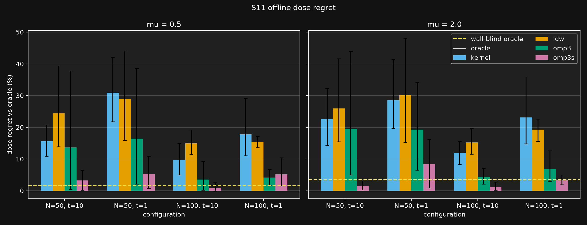

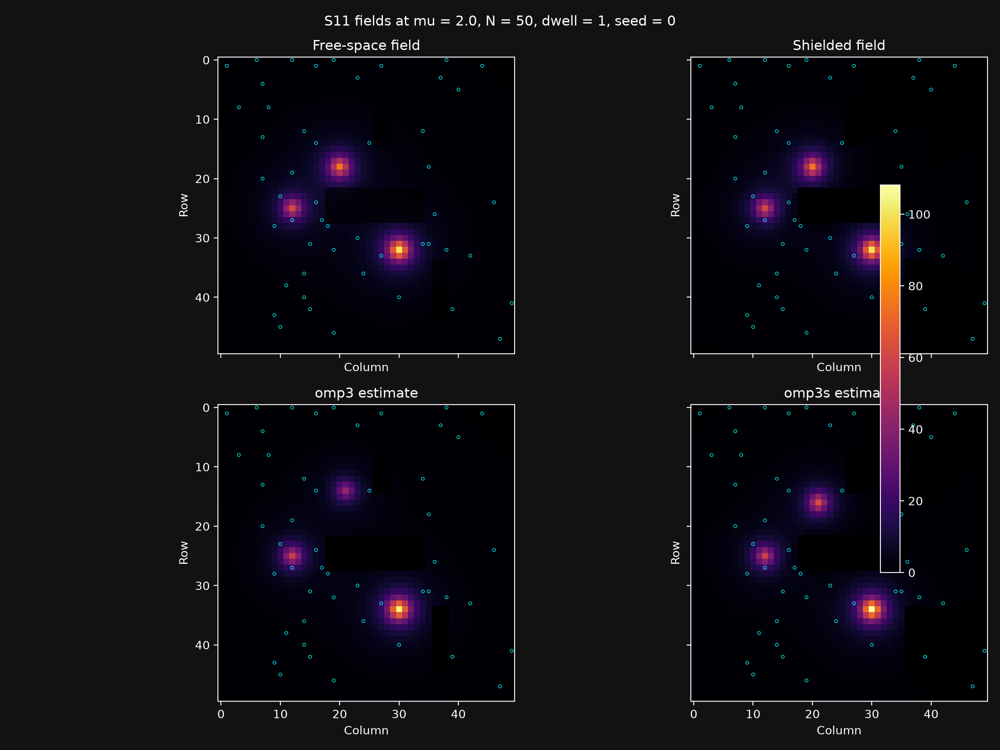

What the numbers show

Hypothesis: H1 is unclear for this shielding comparison. At mu = 2.0 and N = 50 dwell 1, the omp3 interval is 19.2% [6.5, 34.1] and overlaps the 8.4% [0.9, 16.2] omp3s interval; there is no direct same-study interval separating shielding effects from the S10 baseline.

Hypothesis: H2 is supported. At mu = 2.0 and N = 50 dwell 10, omp3s has 1.5% [0.2, 3.1] regret versus 19.6% [5.0, 43.9] for omp3; the intervals do not overlap.

Hypothesis: H3 is supported by the layout-dependent wall-blind regret numbers: 1.5% at mu = 0.5 and 3.4% at mu = 2.0.

Limitations: shielding is straight-line attenuation only with no scattering; walls and mu are known to the shield-aware estimator; the study uses one layout, one offline model, and 25 starts. The seed fallback was not applied.
| A* shortest dose (a.u.) | 119.148 | 119.148 | 119.148 | 119.148 | 119.148 | 119.148 | 119.148 | 119.148 | 119.148 |

Hypothesis: the best tested configuration in this table is kernel regression at N=50 and t=1, with 15.171% dose regret and 47.395% dose reduction versus A* shortest.

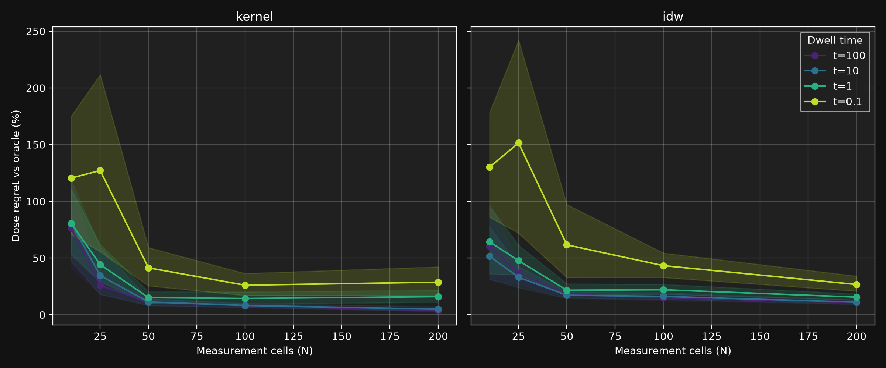

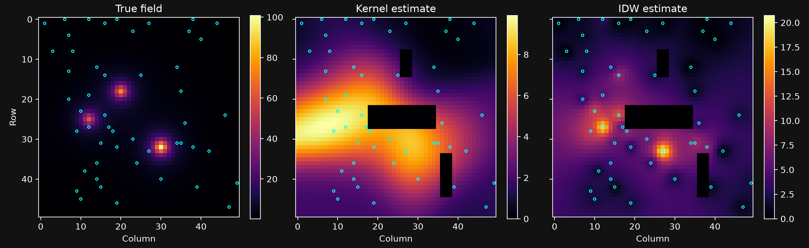

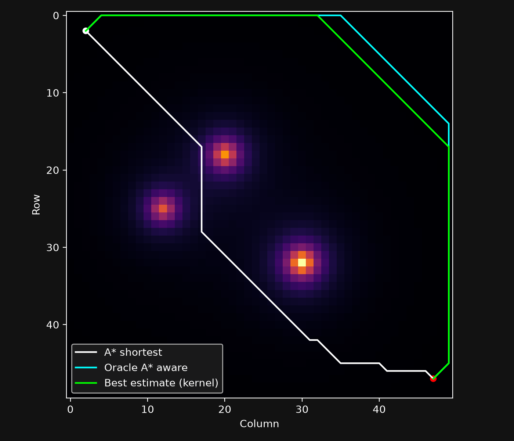

Hypothesis: dose saving breaks down below half of the oracle saving at N=10 in the tested range; it is also below that threshold for some very short-dwell configurations.

Limitations: the study uses two simple estimators, does not count measurement travel cost, uses an idealised Poisson noise model, and evaluates one layout.

## Online measure, estimate, replan

The S8 question is how much of the oracle's dose saving remains when the robot measures only along its own path, re-estimates the field, and replans while walking, compared with offline random measurement cells using the same number of distinct cells.

Assumptions: walls and the goal are known; readings along the robot's own path take no extra time or dose; movement is noise-free; replanning occurs every 3 steps; evaluation uses 25 starts, 5 noise seeds, and one layout.

The 12 configurations are estimators `kernel` and `idw`, patterns `cell` and `3x3`, and dwell values \(t \in \{10, 1, 0.1\}\).

| Estimator / reference | Pattern | Dwell | Online regret % | Offline-matched regret % | Online reduction % | Offline-matched reduction % |
|---|---|---:|---:|---:|---:|---:|
| Oracle reference | - | - | 0.0 | - | 48.0 | - |
| A* shortest reference | - | - | 92.4 | - | 0.0 | - |
| Kernel | cell | 10 | 86.6 | 25.9 | 3.0 | 34.5 |
| Kernel | cell | 1 | 99.0 | 32.0 | -3.4 | 31.4 |
| Kernel | cell | 0.1 | 101.5 | 43.3 | -4.7 | 25.5 |
| Kernel | 3x3 | 10 | 66.6 | 7.8 | 13.4 | 44.0 |
| Kernel | 3x3 | 1 | 89.2 | 25.1 | 1.7 | 35.0 |
| Kernel | 3x3 | 0.1 | 117.8 | 16.2 | -13.2 | 39.6 |
| IDW | cell | 10 | 81.1 | 23.3 | 5.9 | 35.9 |
| IDW | cell | 1 | 84.1 | 45.4 | 4.3 | 24.5 |
| IDW | cell | 0.1 | 92.8 | 50.2 | -0.2 | 22.0 |
| IDW | 3x3 | 10 | 72.6 | 10.6 | 10.3 | 42.5 |
| IDW | 3x3 | 1 | 77.5 | 12.5 | 7.8 | 41.5 |
| IDW | 3x3 | 0.1 | 85.7 | 28.7 | 3.5 | 33.1 |

Reference mean doses are 56.2 a.u. for the oracle and 108.2 a.u. for A* shortest; the oracle saving is 48.0%.

Hypothesis: the online robot loses dose saving in the tested range for kernel `cell` at dwell 1 and 0.1, kernel `3x3` at dwell 0.1, and IDW `cell` at dwell 0.1, where online reduction is negative.

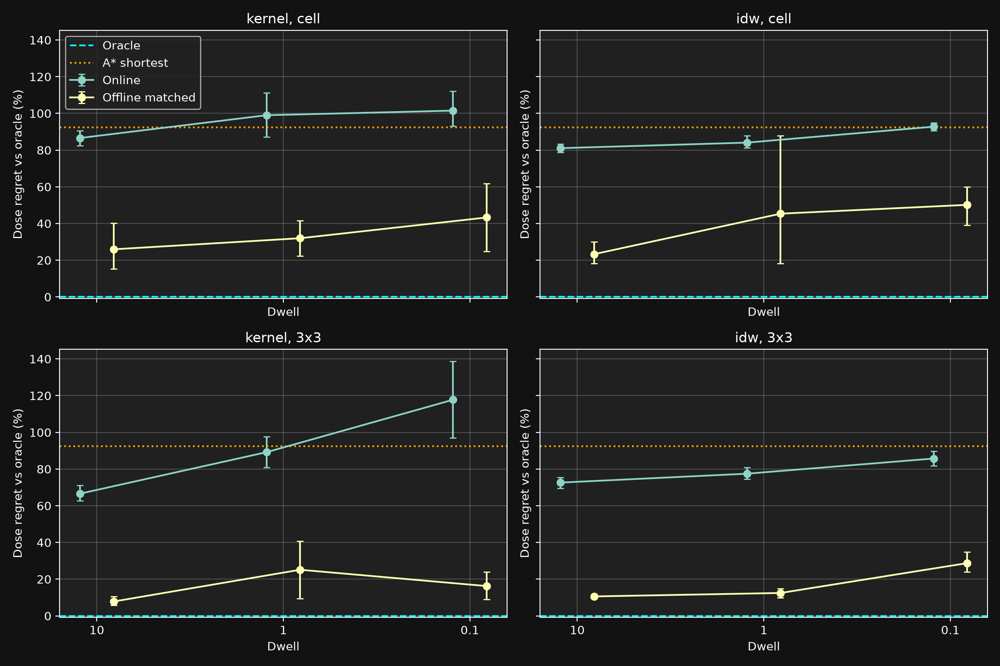

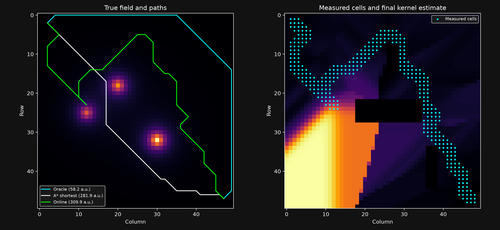

Limitations: the study uses two simple estimators, one layout, readings cost nothing, movement is perfect, and the offline reference is optimistic because random cells can be anywhere.

## Controls, sensor range and unexplored cells

Hypothesis: S8 showed that online measurement loses most of the dose saving because the robot only sees the cells it visits and replans from a partial map.

### Controls

| control | max abs difference | passed |
|---|---:|---|
| true | 0 | True |
| zero | 0 | True |

### Diagnostic and settings

Hypothesis: The noise-free diagnostic uses readings equal to the true field at measured cells, isolating partial-map effects from Poisson noise.

Sensor patterns are `cell`, `3x3`, `disc3`, and `disc6`; the disc patterns measure free cells within their named Euclidean radius.

The unexplored-cell inflation rule replaces each sufficiently distant free-cell planning value with `max(estimate, beta * m)`, where `m` is the mean measured intensity estimate; beta 0 is the baseline and beta 2 is pessimistic.

### Noise-free results

| estimator / pattern | success rate | distinct cells | dose regret % | dose reduction % |
| --- | --- | --- | --- | --- |
| kernel / cell | 1.0 | 36.7 | 100.8 | -4.4 |
| kernel / 3x3 | 1.0 | 141.0 | 53.0 | 20.5 |
| kernel / disc3 | 1.0 | 274.6 | 42.6 | 25.9 |
| kernel / disc6 | 1.0 | 489.5 | 6.6 | 44.6 |
| idw / cell | 1.0 | 35.5 | 85.1 | 3.8 |
| idw / 3x3 | 1.0 | 135.8 | 73.7 | 9.7 |
| idw / disc3 | 1.0 | 262.5 | 68.8 | 12.3 |
| idw / disc6 | 1.0 | 464.2 | 47.0 | 23.6 |

### Noisy results: kernel

| pattern / dwell / beta | success rate | distinct cells | replans | mean steps | dose regret % [95% CI] | dose reduction % [95% CI] |
| --- | --- | --- | --- | --- | --- | --- |
| 3x3 / 10 / 0 (S8) | 1.0 | 142.5 | 12.4 | 36.1 | 66.6 [62.6, 71.2] | 13.4 [11.0, 15.5] |
| 3x3 / 10 / 2 (S9) | 1.0 | 138.2 | 12.2 | 35.4 | 74.0 [72.3, 75.5] | 9.6 [8.8, 10.5] |
| 3x3 / 1 / 0 (S8) | 1.0 | 149.7 | 13.0 | 37.9 | 89.2 [80.8, 97.6] | 1.7 [-2.7, 6.0] |
| 3x3 / 1 / 2 (S9) | 1.0 | 139.6 | 12.2 | 35.5 | 81.0 [74.6, 89.2] | 5.9 [1.7, 9.3] |
| disc3 / 10 / 0 (S9) | 1.0 | 274.4 | 12.7 | 37.0 | 46.4 [38.7, 52.3] | 23.9 [20.9, 27.9] |
| disc3 / 10 / 2 (S9) | 1.0 | 267.6 | 12.1 | 35.2 | 57.8 [56.3, 59.5] | 18.0 [17.1, 18.8] |
| disc3 / 1 / 0 (S9) | 1.0 | 278.1 | 13.4 | 39.0 | 56.9 [50.9, 63.5] | 18.5 [15.0, 21.6] |
| disc3 / 1 / 2 (S9) | 1.0 | 268.3 | 12.5 | 36.3 | 62.5 [61.9, 63.4] | 15.5 [15.1, 15.9] |
| disc6 / 10 / 0 (S9) | 1.0 | 481.5 | 13.7 | 40.1 | 12.3 [10.3, 15.6] | 41.6 [39.9, 42.7] |
| disc6 / 10 / 2 (S9) | 1.0 | 472.8 | 12.9 | 37.7 | 31.3 [26.2, 36.3] | 31.8 [29.2, 34.4] |
| disc6 / 1 / 0 (S9) | 1.0 | 477.0 | 13.8 | 40.2 | 28.0 [25.3, 31.3] | 33.5 [31.8, 34.9] |
| disc6 / 1 / 2 (S9) | 1.0 | 466.8 | 12.9 | 37.5 | 37.6 [34.5, 41.1] | 28.5 [26.6, 30.1] |

### Noisy results: idw

| pattern / dwell / beta | success rate | distinct cells | replans | mean steps | dose regret % [95% CI] | dose reduction % [95% CI] |
| --- | --- | --- | --- | --- | --- | --- |
| 3x3 / 10 / 0 (S8) | 1.0 | 137.0 | 11.9 | 34.6 | 72.6 [69.6, 75.5] | 10.3 [8.8, 11.8] |
| 3x3 / 10 / 2 (S9) | 1.0 | 136.8 | 12.0 | 34.9 | 80.6 [78.1, 83.1] | 6.1 [4.8, 7.5] |
| 3x3 / 1 / 0 (S8) | 1.0 | 137.5 | 12.0 | 34.7 | 77.5 [74.5, 81.0] | 7.8 [6.0, 9.3] |
| 3x3 / 1 / 2 (S9) | 1.0 | 136.8 | 12.0 | 34.9 | 82.5 [78.9, 86.9] | 5.2 [2.8, 7.0] |
| disc3 / 10 / 0 (S9) | 1.0 | 265.5 | 12.0 | 34.9 | 68.3 [64.6, 72.4] | 12.5 [10.4, 14.5] |
| disc3 / 10 / 2 (S9) | 1.0 | 265.2 | 12.0 | 34.8 | 63.7 [63.4, 64.1] | 14.9 [14.7, 15.1] |
| disc3 / 1 / 0 (S9) | 1.0 | 265.3 | 12.1 | 35.0 | 70.0 [64.3, 75.6] | 11.7 [8.7, 14.6] |
| disc3 / 1 / 2 (S9) | 1.0 | 264.2 | 12.0 | 34.9 | 67.9 [66.8, 69.0] | 12.7 [12.1, 13.3] |
| disc6 / 10 / 0 (S9) | 1.0 | 466.5 | 12.6 | 36.6 | 43.6 [41.0, 46.2] | 25.4 [24.0, 26.7] |
| disc6 / 10 / 2 (S9) | 1.0 | 456.6 | 12.2 | 35.3 | 48.5 [47.9, 48.8] | 22.8 [22.7, 23.1] |
| disc6 / 1 / 0 (S9) | 1.0 | 464.4 | 12.6 | 36.6 | 43.1 [39.9, 46.3] | 25.6 [24.0, 27.3] |
| disc6 / 1 / 2 (S9) | 1.0 | 456.7 | 12.2 | 35.3 | 48.6 [47.7, 49.5] | 22.8 [22.3, 23.2] |

### Figures

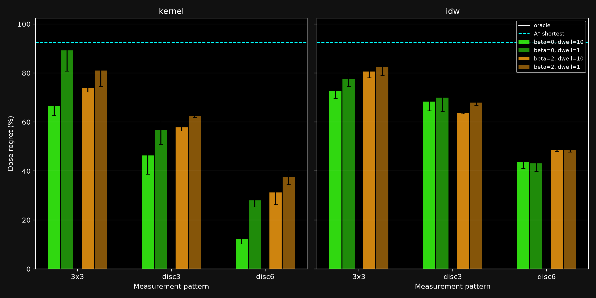

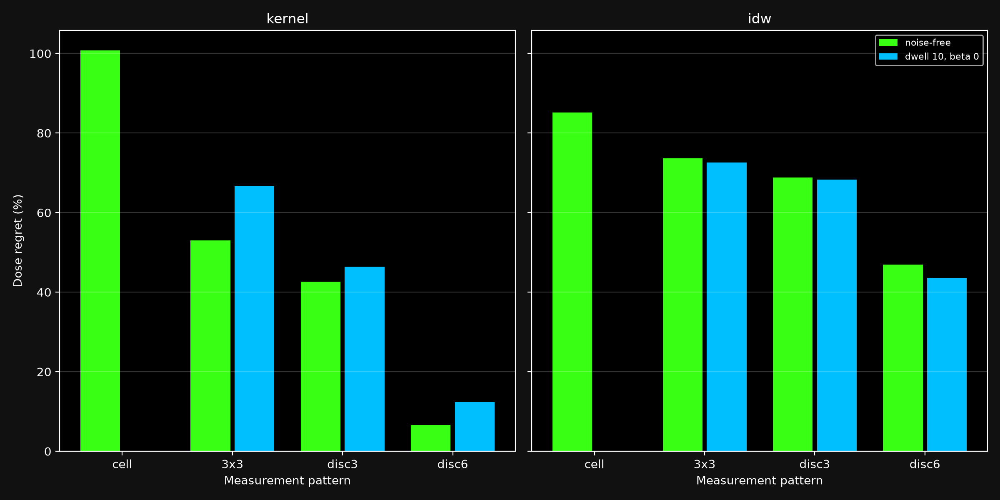

### What the numbers show

Hypothesis: Kernel `disc6`, dwell 10, beta 0 has 12.3 [10.3, 15.6]% regret versus 66.6 [62.6, 71.2]% for `3x3`; the intervals do not overlap, supporting lower regret for `disc6`.

Hypothesis: For kernel `disc6` at dwell 10, beta 2 has 31.3 [26.2, 36.3]% regret versus 12.3 [10.3, 15.6]% at beta 0; the intervals do not overlap, supporting higher regret with inflation.

Hypothesis: At `disc6`, dwell 10, beta 0, kernel has 12.3 [10.3, 15.6]% regret versus idw's 43.6 [41.0, 46.2]%; the intervals do not overlap, supporting lower kernel regret. Other comparisons with overlapping intervals are not distinguishable with 5 seeds.

### Limitations

One layout, two simple estimators, readings cost nothing, and movement is perfect. S9 uses 25 starts. S9 and S7 are not directly comparable because the start sets differ.

## Physics-informed field estimator

Kernel and idw estimate the field from nearby measurements, so they cannot reliably extrapolate to hotspots that have not yet been observed. S10 adds a parametric estimator, `omp<K>`, whose field is a sum of softened inverse-square point sources with nonnegative weights. It uses greedy orthogonal matching pursuit over all grid cells, followed by exchange refinement, with clipped least-squares weights.

The inverse-square form, the softening, and the number of sources K = 3 are assumed known. This is strong physics knowledge, so the comparison with kernel and idw is not like for like. The estimator receives only measured cells, measured intensities, and the free-cell mask.

### S10 reference paths

| metric | mean |
|---|---:|
| oracle dose | 56.2 |
| A* shortest dose | 108.2 |
| oracle steps | 42.2 |
| A* shortest steps | 34.5 |
| oracle saving percent | 48.0 |

### S10 offline results

| N | dwell | kernel regret [95% CI] / L2 | idw regret [95% CI] / L2 | omp3 regret [95% CI] / L2 |
|---:|---:|---:|---:|---:|
| 25 | 10 | 16.6 [10.8, 23.1] / 0.80 | 30.6 [15.6, 49.6] / 0.81 | 10.1 [5.0, 15.2] / 0.87 |
| 25 | 1 | 26.8 [14.3, 40.3] / 0.81 | 43.5 [15.9, 87.6] / 0.81 | 19.2 [10.9, 26.6] / 1.14 |
| 25 | 0.1 | 68.7 [51.7, 86.3] / 0.88 | 70.2 [46.1, 103.0] / 0.89 | 67.1 [46.3, 87.1] / 1.17 |
| 50 | 10 | 8.5 [5.2, 13.7] / 0.77 | 14.9 [12.8, 17.0] / 0.72 | 3.0 [0.3, 6.8] / 0.53 |
| 50 | 1 | 10.7 [7.8, 13.2] / 0.76 | 18.2 [14.2, 22.2] / 0.72 | 4.8 [0.2, 12.2] / 0.56 |
| 50 | 0.1 | 54.0 [36.0, 76.3] / 0.86 | 65.6 [47.9, 84.3] / 0.82 | 32.6 [12.7, 52.5] / 1.11 |
| 100 | 10 | 6.9 [4.2, 10.1] / 0.66 | 13.6 [10.7, 16.6] / 0.63 | 1.5 [0.0, 4.3] / 0.49 |
| 100 | 1 | 11.3 [7.7, 14.1] / 0.67 | 18.5 [14.3, 23.4] / 0.63 | 3.4 [0.5, 7.4] / 0.78 |
| 100 | 0.1 | 26.7 [16.3, 37.1] / 0.75 | 32.5 [21.1, 46.3] / 0.71 | 18.8 [6.0, 32.7] / 0.80 |

### S10 online results

| pattern | dwell | omp3 regret [95% CI] | omp3 success | omp3 distinct cells | S8 kernel regret [95% CI] | S8 idw regret [95% CI] |
|---|---:|---:|---:|---:|---:|---:|
| cell | 10 | 49.5 [40.0, 59.0] | 1.0 | 42.8 | 86.6 [82.5, 90.7] | 81.1 [78.8, 83.3] |
| cell | 1 | 99.7 [85.5, 120.5] | 1.0 | 41.6 | 99.0 [87.3, 111.2] | 84.1 [81.2, 87.9] |
| cell | 0.1 | 132.8 [119.2, 143.8] | 1.0 | 41.3 | 101.5 [93.1, 112.1] | 92.8 [90.7, 94.9] |
| 3x3 | 10 | 12.6 [10.9, 14.2] | 1.0 | 140.2 | 66.6 [62.6, 71.2] | 72.6 [69.6, 75.5] |
| 3x3 | 1 | 30.8 [26.5, 35.3] | 1.0 | 149.3 | 89.2 [80.8, 97.6] | 77.5 [74.5, 81.0] |
| 3x3 | 0.1 | 84.6 [74.5, 94.6] | 1.0 | 162.8 | 117.8 [96.9, 138.7] | 85.7 [81.8, 89.6] |

### Misspecification

| estimator | offline regret [95% CI] | offline L2 error | online regret [95% CI] |
|---|---:|---:|---:|
| omp2 | 8.7 [4.0, 15.8] | 0.69 | 29.2 [27.1, 31.9] |
| omp3 | 4.8 [0.2, 12.2] | 0.56 | 30.8 [26.5, 35.3] |
| omp4 | 5.0 [0.4, 12.1] | 0.54 | 36.3 [30.5, 42.6] |

### S10 figures

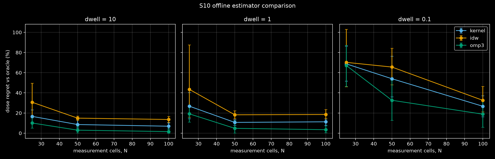

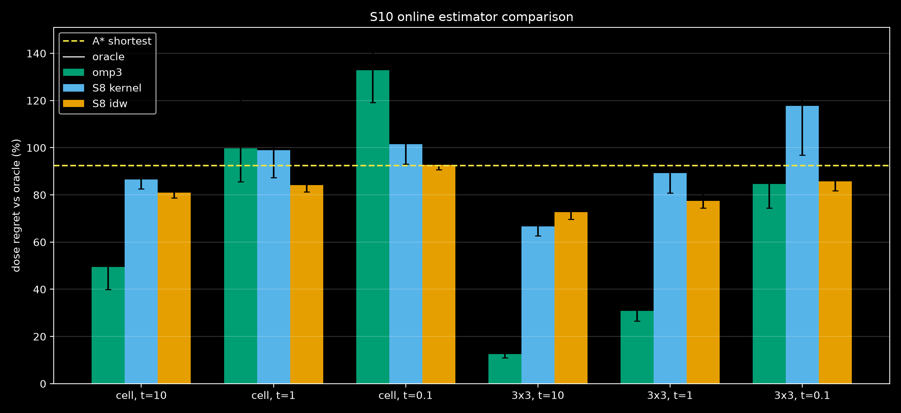

### What the numbers show

Hypothesis: H1 is supported for online extrapolation cases: omp3 has lower regret than both S8 baselines at cell dwell 10 and 3x3 dwell 10, with non-overlapping intervals. Comparisons whose intervals overlap are not distinguishable with 5 seeds.

Hypothesis: H2 is unclear. The omp2, omp3, and omp4 offline and online confidence intervals overlap, so the effect of using the wrong source count is not distinguishable with 5 seeds.

Hypothesis: H3 is supported. At N = 100 and dwell 1, omp3 has lower regret than kernel despite a higher field L2 error, showing that field error and dose regret can disagree.

The estimator does not always recover the true sources: the noise-free N = 200 test recovered them in 19 of 20 trials.

### Limitations

One layout, a strong physics assumption, readings cost nothing, movement is perfect, and the evaluation uses the fixed S10 start set. S10 online numbers use the same noise seeds as S8. The completed study used seeds 0 to 4, so the fallback rule was not applied.
