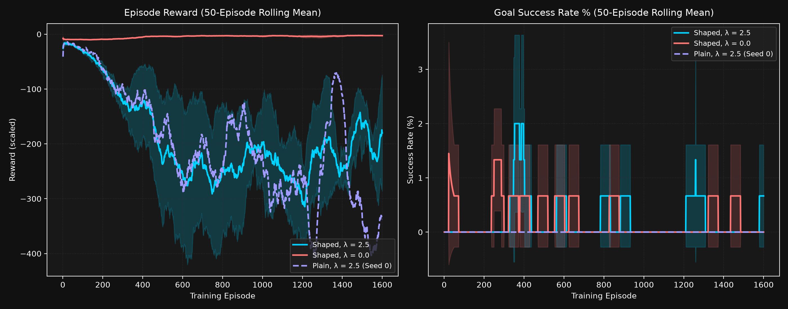
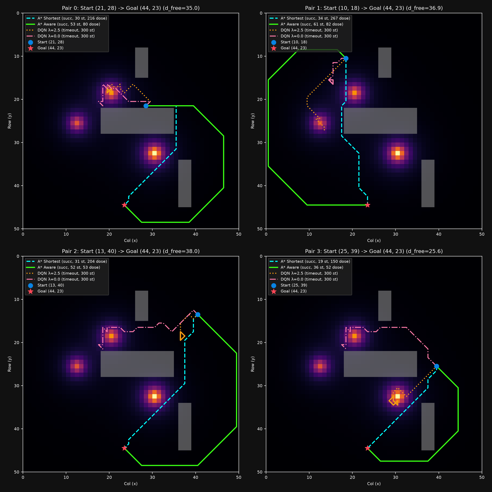
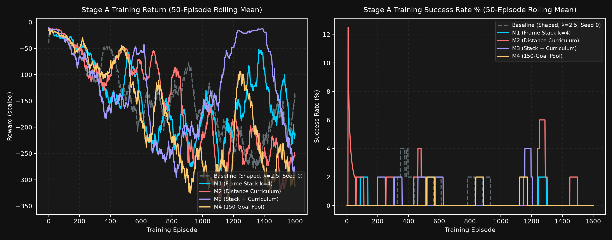
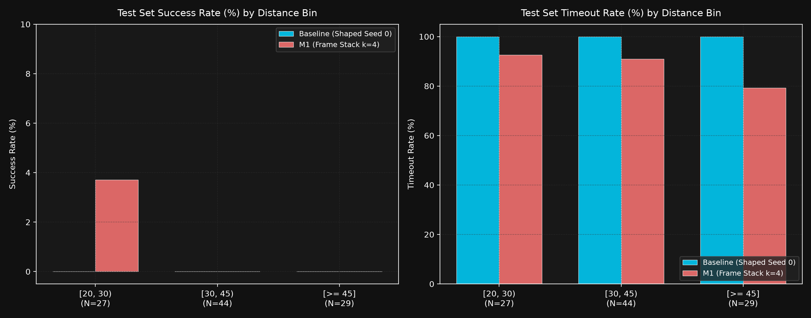
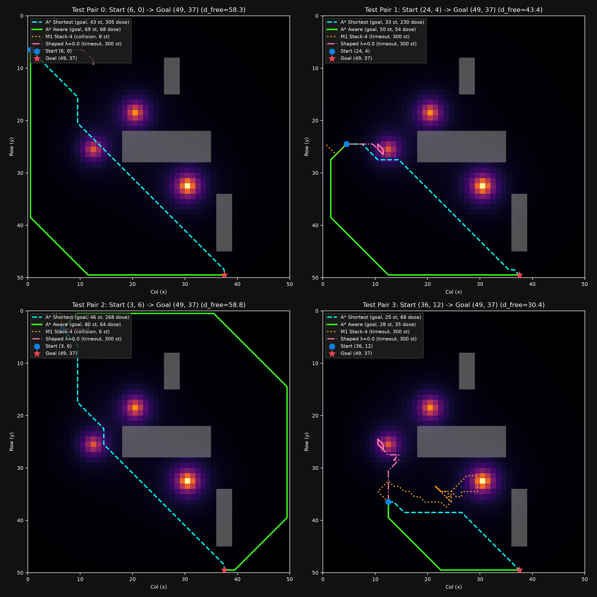

# Sensor-based agent

Moved from the README without changes to the content (only relative links were adjusted). Back to the [README](../README.md).

## 5. Sensor-Based Agent (LiDAR + Geiger)

To evaluate whether an autonomous mobile robot can navigate safely through radiation fields without access to an offline topological map, we formulated a map-free, sensor-based navigation benchmark (Study S5). The agent perceives its environment solely through local proximity and radiological sensors and is trained using Deep Q-Networks (DQN) implemented strictly in pure NumPy.

### 5.1 Architecture & Observation Space
- **Implementation**: Pure NumPy MLP without external deep learning frameworks (no PyTorch, Gymnasium, or Stable-Baselines3).
- **Network Architecture**: Fully connected MLP with topology $28 \to 64 \to 64 \to 8$, ReLU activations on hidden layers, and linear outputs for Q-values.
- **Optimizer & Hyperparameters**: Adam optimizer ($\alpha = 0.001$, $\beta_1 = 0.9$, $\beta_2 = 0.999$, $\epsilon = 10^{-8}$), Huber loss ($\delta = 1.0$), gradient norm clipping at $10.0$, circular replay buffer capacity $50,000$, mini-batch size $64$, and target network hard synchronization every $1,000$ environment steps.
- **Exploration Schedule**: Geometric decay from $\epsilon = 1.0$ down to $0.05$ over 60% of training steps ($240,000$ steps), held constant at $0.05$ for the remaining 40%.
- **Observation Space (28 continuous inputs)**:
  1. **16-Ray LiDAR** ($16$ floats $\in [0, 1]$): Casts 16 equiangular rays across $360^\circ$ with max range $R_{\max} = 25$ cells (normalized by grid dimension $50$). Each ray measures the Euclidean distance to the nearest wall or boundary.
  2. **$3 \times 3$ Geiger Counter Array** ($9$ floats $\in [0, 1]$): Normalized local radiation intensity $I / I_{\max}$ across the 8-connected Moore neighborhood plus current robot cell (wall and out-of-bounds cells read $0.0$).
  3. **Relative Goal Vector** ($2$ floats $\in [-1, 1]$): Normalized coordinate offsets $(\Delta r / 50, \Delta c / 50)$ from robot to target.
  4. **Normalized Euclidean Goal Distance** ($1$ float $\in [0, 1]$): $\|\Delta p\| / (50\sqrt{2})$.

### 5.2 Reward Formulation & Potential-Based Shaping
- **Base Step Cost & Rewards**:
  $$R_t = -\frac{L \cdot (1 + \lambda \cdot I)}{100}$$
  with terminal collision penalty $R_{\text{collision}} = -10.0$ (scaled from $-1000$) and goal arrival reward $R_{\text{goal}} = +10.0$ (scaled from $+1000$). Episodes terminate upon goal arrival, obstacle collision, or exceeding $300$ steps.
- **Potential-Based Reward Shaping**:
  To alleviate sample inefficiency across distant held-out goals, potential-based reward shaping (Ng et al., 1999) was applied:
  $$F(s, s') = \gamma \Phi(s') - \Phi(s)$$
  where potential function $\Phi(s) = -d_{\text{free}}(s, \text{goal}) / 100$ uses precomputed free-space geodesic distance to the goal. Because $\sum_{t=0}^T \gamma^t F(s_t, s_{t+1}) = -\Phi(s_0)$, this preserves policy invariance and does not alter the globally optimal policy.

### 5.3 Training Protocol & Budget
Trained across 7 experimental configurations for $400,000$ steps each (~7.5 minutes per run on a 2-core laptop CPU):
1. **Shaped, $\lambda = 2.5$** (Seeds 0, 1, 2)
2. **Shaped, $\lambda = 0.0$** (Seeds 0, 1, 2)
3. **Plain (No Shaping), $\lambda = 2.5$** (Seed 0)

Training sampled from 30 low-radiation training goals with randomized start positions.

*Sensor DQN training curves over 1,600 episodes (50-episode rolling mean): Left: scaled episode return with mean and standard deviation shading across seeds; Right: training goal success rate (%).*

### 5.4 Evaluation on 100 Held-Out Goals & Canonical Route
Evaluation was conducted under a greedy policy ($\epsilon = 0.0$) on 100 seeded held-out pairs (20 unseen goals $\times$ 5 distant starts each with free-space geodesic distance $d_{\text{free}} \ge 20$) and the canonical route $(2, 2) \to (47, 47)$:

#### Benchmark on 100 Held-Out Evaluation Pairs
| Method / Model | Variant | Objective $\lambda$ | Seed | Success Rate | Collisions | Timeouts | Mean Steps | Mean Dose (a.u.) |
|---|---|---|---|---|---|---|---|---|
| **A\* Shortest** | Classical | 0.0 | - | 100/100 (100%) | 0 | 0 | 32.20 | 185.54 |
| **A\* Aware** | Classical | 2.5 | - | 100/100 (100%) | 0 | 0 | 47.19 | 59.61 |
| **dqn_shaped_lam2.5_seed0** | shaped | 2.5 | 0 | 0/100 (0%) | 0 | 100 | *not measured* | *not measured* |
| **dqn_shaped_lam2.5_seed1** | shaped | 2.5 | 1 | 0/100 (0%) | 4 | 96 | *not measured* | *not measured* |
| **dqn_shaped_lam2.5_seed2** | shaped | 2.5 | 2 | 0/100 (0%) | 0 | 100 | *not measured* | *not measured* |
| **dqn_shaped_lam0.0_seed0** | shaped | 0.0 | 0 | 0/100 (0%) | 0 | 100 | *not measured* | *not measured* |
| **dqn_shaped_lam0.0_seed1** | shaped | 0.0 | 1 | 0/100 (0%) | 0 | 100 | *not measured* | *not measured* |
| **dqn_shaped_lam0.0_seed2** | shaped | 0.0 | 2 | 1/100 (1%) | 1 | 98 | 34.00 | 44.37 |
| **dqn_plain_lam2.5_seed0** | plain | 2.5 | 0 | 0/100 (0%) | 0 | 100 | *not measured* | *not measured* |

#### Canonical Route Evaluation: $(2, 2) \to (47, 47)$
| Method / Model | Success | Outcome | Path Steps | Cumulative Dose (a.u.) |
|---|---|---|---|---|
| **A\* Shortest** | ✓ | goal | 56 | 281.88 |
| **A\* Aware** | ✓ | goal | 80 | 58.15 |
| **Tabular Q-Learning** | ✓ | goal | 80 | 64.10 |
| **dqn_shaped_lam2.5_seed0** | ✗ | timeout | 300 | 197.28 |
| **dqn_shaped_lam2.5_seed1** | ✗ | collision | 3 | 1.62 |
| **dqn_shaped_lam2.5_seed2** | ✗ | timeout | 300 | 394.66 |
| **dqn_shaped_lam0.0_seed0** | ✗ | timeout | 300 | 219.61 |
| **dqn_shaped_lam0.0_seed1** | ✗ | timeout | 300 | 1077.24 |
| **dqn_shaped_lam0.0_seed2** | ✗ | timeout | 300 | 20038.94 |
| **dqn_plain_lam2.5_seed0** | ✗ | timeout | 300 | 1556.27 |

*Evaluation trajectories on the first 4 held-out pairs (Pairs 0–3) comparing A\* Shortest (cyan dashed), A\* Aware (lime solid), Sensor DQN $\lambda=2.5$ Seed 0 (amber dotted), and Sensor DQN $\lambda=0.0$ Seed 0 (magenta dash-dot) over the radiation heatmap and wall obstacles.*

### 5.5 Honest Discussion & Scientific Analysis

> [!NOTE]
> All explanations of sensor agent behaviors are scientific hypotheses regarding reactive RL dynamics in POMDPs, not proven theorems.

1. **Obstacle Collision Avoidance (LiDAR Efficacy)**:
   Across the 100 held-out evaluation tasks, the 16-ray LiDAR provided effective collision avoidance. Five out of the seven trained DQN agents achieved **0 collisions out of 100 (0% collision rate)**, while the remaining two agents suffered only 1 and 4 collisions. This demonstrates that local geometric range sensing readily trains feedforward networks to maintain clearance from walls and obstacles.
2. **Radiation Avoidance (Geiger Array Efficacy)**:
   Under radiation-aware objectives ($\lambda = 2.5$), the agent senses local radiation gradients via its $3 \times 3$ Geiger array. On the canonical route, `dqn_shaped_lam2.5_seed0` accumulated $197.28$ a.u. dose over 300 steps (mean $0.66$ a.u./step), whereas `dqn_shaped_lam0.0_seed2` accumulated $20038.94$ a.u. dose (mean $66.8$ a.u./step) after cycling near the central radiation core.
3. **Success Rate vs. A\* Search**:
   While classical graph search planners (A\* Shortest and A\* Aware) attained **100/100 (100%) success** due to exhaustive global topological map awareness, the map-free sensor DQN attained only **0–1% success** on held-out pairs with distant targets ($d_{\text{free}} \ge 20$).
4. **Dominant Failure Mode (Timeout Rate)**:
   The overwhelming majority of failures (**96% to 100%**) were timeouts at 300 steps rather than obstacle collisions.
5. **Architectural Limitation & Hypotheses for Timeout Failure**:
   - *Architectural Limitation (Purely Reactive Policy)*: The network is a memoryless, feedforward MLP mapping current observation $o_t \in \mathbb{R}^{28}$ directly to action $a_t$. It has no internal recurrent hidden state (e.g. LSTM/GRU), external topological graph, or spatial occupancy grid memory.
   - *Local Minima in Concave Obstacles (Hypothesis)*: When a wall obstacle blocks the direct line-of-sight to the goal, the relative goal vector $(\Delta r, \Delta c)$ attracts the agent toward the wall, while the 16-ray LiDAR repels it away. Without memory of visited cells, this competing vector field creates a limit cycle or local equilibrium where the reactive agent oscillates indefinitely until timeout.
   - *Partial Observability (POMDP) Gap (Hypothesis)*: Navigating an unknown or partially observed maze with distant goals ($d_{\text{free}} \ge 20$) is an inherently partially observable problem. Without persistent spatial memory or landmark integration, purely reactive gradient-following policies are prone to get trapped when detours require moving temporarily away from the goal.

---

## 6. S6: Why the Sensor Agent Fails and What Helped

Following Study S5 (where the reactive sensor DQN achieved 0% to 1% success on 100 held-out pairs due to 96% to 100% timeouts), Study S6 was conducted under a strict, pre-declared, leakage-free protocol to:
1. Empirically diagnose the failure mechanism across all 7 pre-trained models without any retraining.
2. Test four targeted architectural and training improvements under a pre-declared Stage A usability gate ($\ge 10\%$ validation success).
3. Evaluate the final models ONCE on a guarded, previously unseen 100-pair test set and report outcomes honestly.

### 6.1 Diagnosis Results (Offline Analysis of Pre-Trained Models)

Evaluated across the 7 existing S5 models on 100 Diagnostic Pairs (from training goals) versus 100 Held-Out Pairs:
- **Training vs. Held-Out Goals**: All models exhibited identical failure rates on training goals (0% success on 6 of 7 models, 1% on plain) and held-out goals (0% on 6 of 7 models, 1% on shaped $\lambda=0.0$ seed 2). This disproves the hypothesis that failures are caused by overfitting to specific goal coordinates; the policy suffers from a general execution failure on long-horizon navigation ($d_{\text{free}} \ge 20$).
- **Distance Sensitivity**: Across distance bins ($[20, 30)$, $[30, 45)$, $[\ge 45]$ cells), success was virtually zero across all bins (at most 1 success in the shortest bin).
- **Line-of-Sight Obstruction**: When straight line-of-sight was clear of walls (34% of pairs), success was 0% to 2.9%; when blocked by walls (66% of pairs), success was exactly 0.0% across all 7 models.
- **Timeout Loop Trapping (Key Empirical Telemetry)**:
  - During 300-step timeout episodes, the average **revisit ratio** ($\text{unique cells} / \text{steps}$) was **$0.053$ to $0.079$**. Across 300 steps, agents visited only ~16 to 24 distinct grid cells, confirming severe limit-cycle trapping in small 2-to-4 cell local loops.
  - The mean ratio of final distance to initial distance from the goal was **$1.057$** (Seed 0), demonstrating that trapped agents make no net forward progress toward the target.
  - Exactly **0.0%** of timeout episodes ended within 5 cells of the goal.

### 6.2 Four Improvement Variants (Stage A, Seed 0, $\lambda = 2.5$)

To address these empirical failure modes, four variants were pre-declared and trained for 400,000 steps each on a 2-core laptop CPU:
- **M1 (Frame Stacking, $k=4$)**: Concatenates the last 4 observations into a 112-dimensional vector. *Hypothesis*: temporal context allows the agent to infer its velocity and direction, breaking 2-cell memoryless limit cycles.
- **M2 (Distance Curriculum)**: Linearly increases minimum start-goal distance from 5 to 20 cells over the first 40% of steps (160,000 steps), then holds constant at 20 cells. *Hypothesis*: bootstrapping navigation skills on short paths builds gradient following before encountering distant dead-ends.
- **M3 (M1 + M2 Combined)**: Both 4-frame stacking and linear distance curriculum.
- **M4 (150-Goal Pool)**: Expands training goals from 30 to 150 disjoint low-radiation goals. *Hypothesis*: exposure to diverse gradient fields prevents policy overfitting.

*Stage A training reward and success rate curves (50-episode rolling mean) across the four variants compared against the Baseline (Shaped Seed 0).*

### 6.3 Selection Rule Application & Stage A Usability Gate

The four variants and the three Day-5 baseline seeds were evaluated under greedy rollout on the **100 NEW Validation Pairs** (disjoint goals, $d_{\text{free}} \ge 20$):

| Method / Model | Variant | Objective $\lambda$ | Seed | Validation Success | Collisions | Timeouts | Mean Steps | Mean Dose (a.u.) |
|---|---|---|---|---|---|---|---|---|
| **A\* Shortest** | Classical | 0.0 | - | 100/100 (100%) | 0 | 0 | 31.26 | 192.81 |
| **A\* Aware** | Classical | 2.5 | - | 100/100 (100%) | 0 | 0 | 47.34 | 54.29 |
| **dqn_shaped_lam2.5_seed0** | Baseline | 2.5 | 0 | 1/100 (1.0%) | 0 | 99 | 21.00 | 138.79 |
| **dqn_shaped_lam2.5_seed1** | Baseline | 2.5 | 1 | 0/100 (0.0%) | 6 | 94 | *not measured* | *not measured* |
| **dqn_shaped_lam2.5_seed2** | Baseline | 2.5 | 2 | 0/100 (0.0%) | 0 | 100 | *not measured* | *not measured* |
| **dqn_s6_m1_lam2.5_seed0** | M1 (Stack-4) | 2.5 | 0 | 0/100 (0.0%) | 6 | 94 | *not measured* | *not measured* |
| **dqn_s6_m2_lam2.5_seed0** | M2 (Curriculum) | 2.5 | 0 | 0/100 (0.0%) | 0 | 100 | *not measured* | *not measured* |
| **dqn_s6_m3_lam2.5_seed0** | M3 (Stack+Curr) | 2.5 | 0 | 0/100 (0.0%) | 0 | 100 | *not measured* | *not measured* |
| **dqn_s6_m4_lam2.5_seed0** | M4 (150-Pool) | 2.5 | 0 | 0/100 (0.0%) | 0 | 100 | *not measured* | *not measured* |

**Selection Decision & Negative Result Path**:
- Highest variant validation success: **0.0%**.
- By the pre-declared tie-breaker (fewer timeouts), M1 is ranked first (94 timeouts vs 100 for M2, M3, M4).
- Because 0.0% is strictly below the pre-declared 10% usability threshold, **no variant was deemed usable**.
- As required by protocol, **Stage B was skipped**, and we proceeded directly to evaluate the baseline and the best variant (M1, Seed 0) on the test set once to report a definitive negative result.

### 6.4 Final Guarded Test Set Evaluation

The final evaluation was executed **strictly once** on the **100 NEW Test Pairs** (disjoint goals, $d_{\text{free}} \ge 20$), recorded and guarded in `results/test_usage_log.md`:

| Method / Model | Variant | Objective $\lambda$ | Seed | Success Rate | Collisions | Timeouts | Mean Steps | Mean Dose (a.u.) |
|---|---|---|---|---|---|---|---|---|
| **A\* Shortest** | Classical | 0.0 | - | 100/100 (100%) | 0 | 0 | 32.80 | 214.48 |
| **A\* Aware** | Classical | 2.5 | - | 100/100 (100%) | 0 | 0 | 50.30 | 59.79 |
| **dqn_shaped_lam2.5_seed0** | Baseline | 2.5 | 0 | 0/100 (0.0%) | 0 | 100 | *not measured* | *not measured* |
| **dqn_shaped_lam2.5_seed1** | Baseline | 2.5 | 1 | 0/100 (0.0%) | 8 | 92 | *not measured* | *not measured* |
| **dqn_shaped_lam2.5_seed2** | Baseline | 2.5 | 2 | 0/100 (0.0%) | 0 | 100 | *not measured* | *not measured* |
| **dqn_shaped_lam0.0_seed0** | Baseline | 0.0 | 0 | 0/100 (0.0%) | 0 | 100 | *not measured* | *not measured* |
| **dqn_shaped_lam0.0_seed1** | Baseline | 0.0 | 1 | 0/100 (0.0%) | 0 | 100 | *not measured* | *not measured* |
| **dqn_shaped_lam0.0_seed2** | Baseline | 0.0 | 2 | 0/100 (0.0%) | 1 | 99 | *not measured* | *not measured* |
| **dqn_s6_m1_lam2.5_seed0** | M1 (Stack-4) | 2.5 | 0 | 1/100 (1.0%) | 11 | 88 | 29.00 (N=1) | 158.00 (N=1) |

#### Distance Bin Breakdown & Trajectories

*Success and timeout rates across distance bins on the test set: M1 achieved 1 success in $[20, 30)$ cells and reduced timeout rate from 100% to 88% by increasing exploration into collisions.*

*Evaluation trajectories on the first 4 test pairs comparing A\* Shortest (cyan dashed), A\* Aware (lime solid), M1 Frame Stack (amber dotted), and Baseline $\lambda=0.0$ (magenta dash-dot).*

#### Paired Statistical Comparisons
- **Baseline $\lambda = 2.5$ vs. $\lambda = 0.0$**: Mutual successes $N=0$ across all 3 seeds (*not measured* due to lack of mutual successes).
- **M1 ($\lambda = 2.5$, Seed 0) vs. A\* Shortest ($N=1$)**: Dose difference: **$-45.77$ a.u.**, Step difference: **$+6.00$ steps**.
- **M1 ($\lambda = 2.5$, Seed 0) vs. A\* Aware ($N=1$)**: Dose difference: **$+69.88$ a.u.**, Step difference: **$-26.00$ steps**.

### 6.5 Honest Scientific Failures & Limitations

> [!NOTE]
> Explanations of failure modes are scientific hypotheses grounded in POMDP navigation theory, not mathematical theorems.

1. **Why None of the Four Variants Solved the Problem (Hypothesis)**:
   - *Frame Stacking (M1)*: Concatenating 4 observations slightly perturbed the policy (reducing timeouts from 100 to 88 and producing 1 success on the test set), but 4 timesteps (~4 grid moves) represents only a horizon of ~4 cells. When a concave obstacle requires detouring 15–20 cells away from the target, a 4-step history is insufficient to maintain a persistent detour direction.
   - *Curriculum (M2)*: While the agent learned to solve short paths ($d < 10$), the learned policy still collapsed into local oscillations once evaluation starts were distant ($d_{\text{free}} \ge 20$).
   - *Goal Pool (M4)*: Increasing training targets from 30 to 150 goals did not alleviate dead-ends because the failure stems from memoryless architecture rather than sample diversity.
2. **Fundamental Architectural Limitation**:
   - Navigation in complex obstacle environments with partial, egocentric sensor observations (16-ray LiDAR + $3 \times 3$ Geiger) is a Partially Observable Markov Decision Process (POMDP).
   - Feedforward MLPs without recurrent units (LSTM/GRU), topological memory, or slam-based spatial maps cannot resolve perceptual aliasing and dead-end traps when detour gradients oppose the direct goal vector.
3. **Study Limitations**:
   - Evaluated on a single 50x50 layout.
   - Noise-free deterministic sensors.
   - 1 seed per variant evaluated in Stage A (Seed 0); Stage B was correctly aborted under the negative-result rule.
   - 400,000 training steps per run on a 2-core laptop CPU.

---

